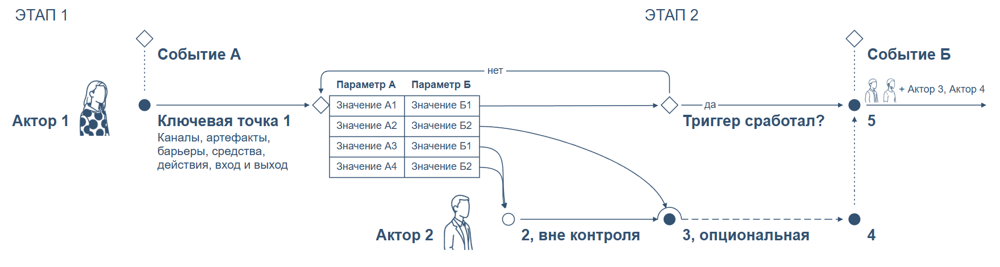
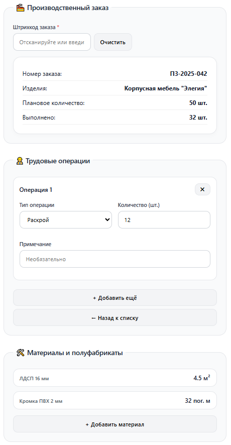
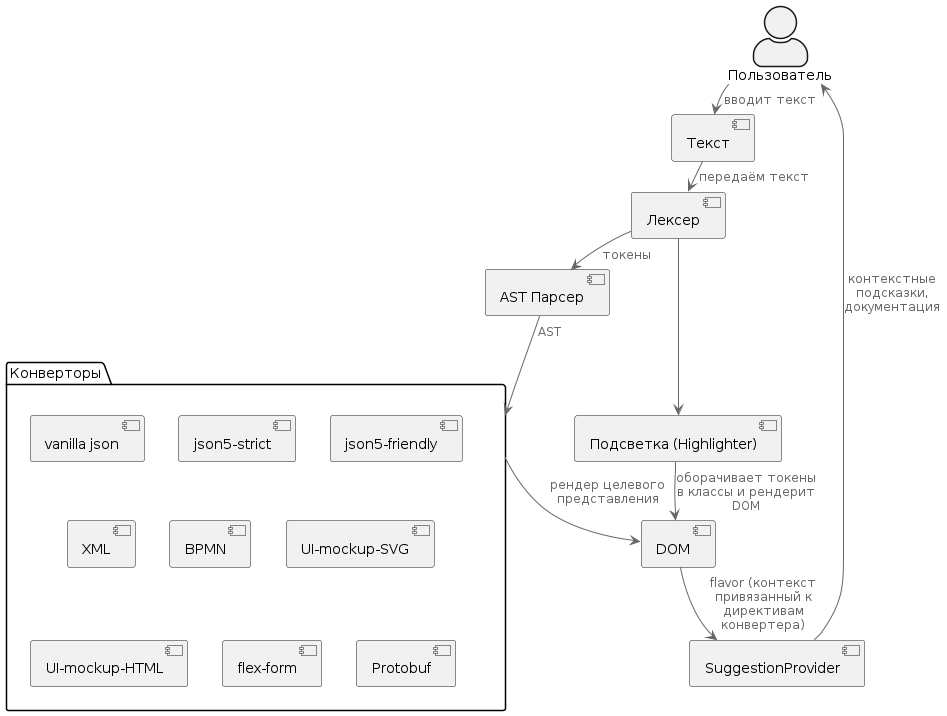
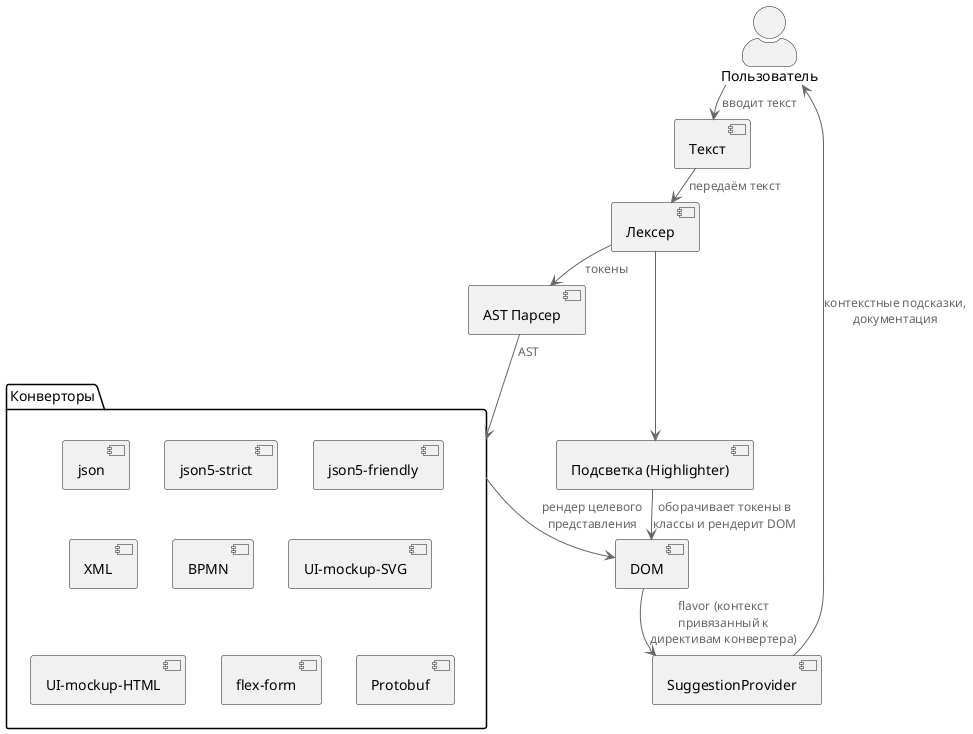
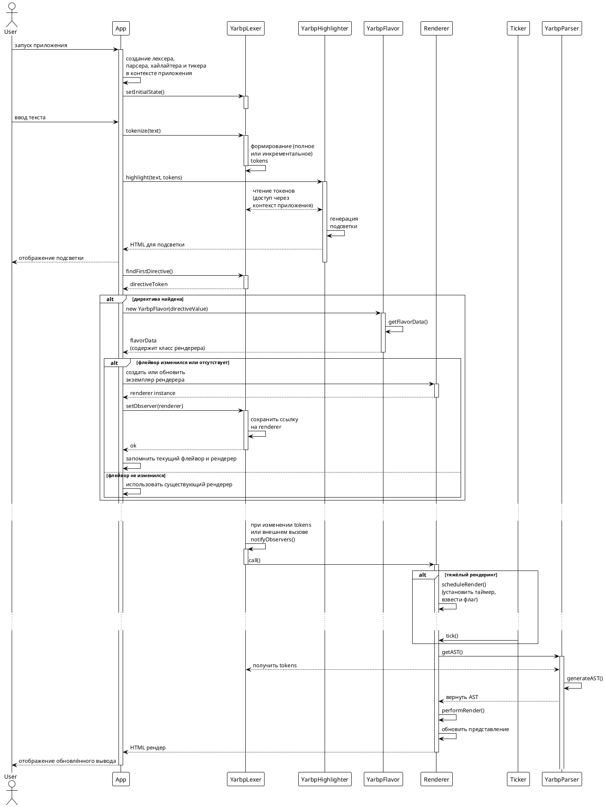

<div align="center">

<h1>Язык разметки для быстрого прототипирования (ЯРБП), v2.0</h1>

<p>
  <a href="https://yarbp.tech/"></a>
  
  
  
</p>

<p>
  <a href="#about">Общее описание</a> ·
  <a href="#sandbox">Песочница</a> ·
  <a href="#syntax">Синтаксис</a> ·
  <a href="#converters">Конвертеры</a> ·
  <a href="#architecture">Архитектура</a>
</p>

</div>

## Содержание

- [Общее описание](#about)
- [Идеи](#ideas)
- [Песочница](#sandbox)
  - [Ссылки на встроенные примеры](#sandbox-examples)
- [Спецификация](#spec)
  - [Синтаксис](#syntax)
    - [Расширенный пример](#advanced-example)
    - [Типизация и комментарии](#typed-comments)
    - [Макросы](#macros)
    - [Сахар и дизайн AST](#sugar-ast)
    - [Карта процесса-опыта](#xpm)
    - [Прикладной пример](#applied-example)
    - [Конвертеры](#converters)
      - [BPMN](#bpmn)
      - [ТСД](#tsd)
    - [Синтаксис в PEG](#peg)
- [Реализация](#implementation)
  - [Архитектура](#architecture)
- [Сообщество](#community)

---

<a id="about"></a>

## Общее описание

**ЯРБП** (Язык Разметки для Быстрого Прототипирования, он же YARBP -
"Yet Another Rapid Business Prototyping") - это язык разметки для
аналитиков, который легко писать и читать. Сверхкомпактный, русскоязычный,
человекочитаемый DSL.
Его главная задача - служить единым, простым источником истины,
из которого можно автоматически сгенерировать что угодно: от макета интерфейса и схемы BPMN до JSON-конфига, Protobuf и XML.

<a id="ideas"></a>

### Идеи:
- Удобство набора (в том числе при работе в русской раскладке)
- Один синтаксис -> одно AST -> множество целевых представлений:
  - разметка: JSON / XML / Protobuf
  - макеты UI
  - BPMN схемы
  - ...
- Широкий набор фич для максимально гибкой разметки целевых сущностей:
  - типизация
  - макросы
  - комментарии
  - директивы конвертера
  - настраиваемый сахар для объявления свойств
- Вся семантика на стороне конвертера - язык определяет только структуру, а смысл придаёт целевой конвертер.
- При этом низкий порог входа. Хотим писать просто - пишем просто, разметка валидна. Хотим писать компактно и удобно - изучаем фичи.

<a id="sandbox"></a>

## Песочница
Песочница с актуальной версией:
https://yarbp.tech/

<a id="sandbox-examples"></a>

### Ссылки на встроенные примеры

Песочницу можно открыть сразу на нужном примере — параметром `example` в адресе:

- https://yarbp.tech/?example=tsd-form — «Форма ТСД»
- https://yarbp.tech/?example=bpmn — «BPMN»

Параметр подставляется в адрес сам при переключении примера в папке «Примеры»,
поэтому ссылку достаточно скопировать из адресной строки и отправить: у получателя
откроется тот же пример, даже если в его localStorage выбран другой файл.
Без параметра песочница открывается как обычно.

| `example` | Пример |
| --- | --- |
| `lexer-output` | Lexer output |
| `ast` | Abstract Syntax Tree |
| `json` | JSON |
| `xml-anonymous` | XML, anonymous objects |
| `xml-explicit` | XML, explicit objects |
| `protobuf` | Protobuf |
| `xpo` | XPO, full example |
| `bpmn` | BPMN |
| `tsd-form` | Форма ТСД |

Принимается и id примера (`?example=builtin-3`), и hash-форма
(`#example=json`); в адресе всегда оказывается читаемый ключ.

<a id="spec"></a>

## Спецификация

<a id="syntax"></a>

### Синтаксис

<a id="advanced-example"></a>

#### Расширенный пример

```yarbp
! as json
:
  .order_id 12345
  .status "new"
  .is_active yes
  :client .first_name Jack .last_name White .id '54312'
  ..items
    : .sku ART-001 .price 1299.99
```

Лидирующие символы указывают на тип ключа.
В предыдущем примере типы ключей выводились автоматически, но их можно указывать явно.
Доступные типы ключей:

| Префикс | Тип ключа |
| :---: | --- |
| `.` | лидирующая точка -> ключ примитивного значения (атрибут объекта) |
| `:` | лидирующее двоеточие -> ключ объекта |
| `..` | лидирующая двойная точка -> ключ массива |

Указание типа ключа без значения ключа объявляет анонимное значение (значение без имени),
см. ниже как сконвертировалось в этом примере корневой объект и объект внутри "items"

Рендер:

```json
{
  "order_id": 12345,
  "status": "new",
  "is_active": true,
  "client": {
    "first_name": "Jack",
    "last_name": "White",
    "id": "54312"
  },
  "items": [
    {
      "sku": "ART-001",
      "price": 1299.99
    }
  ]
}
```

<a id="typed-comments"></a>

#### Пример с типизацей и комментариями

```yarbp
! as proto
Order
  .order_number:string --- comment
  .date:string --- comment
  ..items
    Product .name:string
      .size:enum UNSPECIFIED SMALL MEDIUM LARGE
    .position:int32
```

ЯРБП поддерживает комментарии и типизацию значений.
Типы указываются после ключей через двоеточие как ```ключ:тип```.

Комментарии начинаются с ```---```.

Рендер:

```proto
message Order {
  string order_number = 1;  // comment
  string date = 2;          // comment
  repeated Item items = 3;
}

message Product {
  string name = 1;
  Size size = 2;
}

message Item {
  Product Product = 1;
  int32 position = 2;
}

enum Size {
  UNSPECIFIED = 0;
  SMALL = 1;
  MEDIUM = 2;
  LARGE = 3;
}
```

<a id="macros"></a>

#### Макросы.

Макросы в ЯРБП объявляются лидирующим ```@```. Используются для того чтобы минимизировать написание повторяющегося кода.
Раскрываются на уровне парсера подстановкой, т.о конвертору макросы уже недоступны, AST подается раскрытым.

Определение задаётся как `@a`; имя результата передаётся в вызове: `a(xx)` раскроется в узел `xx`, а `a(yy)` - в `yy`. Вызов без скобок оставляет имя `a`.

Пример:

```yarbp
! as xml

@item
  .id item-(( item-number ))
  ..content
    (( variable-content ))
    extra-content .prop-1 (( prop-1 )) .prop-2 (( prop-2 ))
  controller .name controller-(( item-number ))

items
  item .item-number 1 .prop-1 1 .prop-2 2
    ..variable-content
      sub-item .id 1
  item .item-number 2 .prop-1 3 .prop-2 4
    ..variable-content
      sub-item .id 1
      sub-item .id 2
  item .item-number 3 .prop-1 5 .prop-2 6
    ..variable-content
```

Рендер:

```xml
<items>
  <item id="item-1">
    <content>
      <sub-item id="1"/>
      <extra-content prop-1="1" prop-2="2"/>
    </content>
    <controller name="controller-1"/>
  </item>
  <item id="item-2">
    <content>
      <sub-item id="1"/>
      <sub-item id="2"/>
      <extra-content prop-1="3" prop-2="4"/>
    </content>
    <controller name="controller-2"/>
  </item>
  <item id="item-3">
    <content>
      <extra-content prop-1="5" prop-2="6"/>
    </content>
    <controller name="controller-3"/>
  </item>
</items>
```

<a id="sugar-ast"></a>

#### Сахар и дизайн AST.

Также существует специальный узел "shorthand", использующийся для сокращенного объявления свойств.
Для объявления сахара после имени объекта записывается знак равно.

Сахар может интерпретироваться конвертерами по их усмотрению (см. пример с динамической типизацией сахара в "Прикладной пример").

Пример

```yarbp
! как аст
поле-формы:дата = Дата начала
```

Рендер

```json
{
  "nodeType": "ROOT",
  "directives": [
    {
      "nodeType": "DIRECTIVE",
      "value": "как аст",
      "prefix": "!",
      "position": {
        "start": 0,
        "end": 9
      }
    }
  ],
  "children": [
    {
      "nodeType": "MEANING",
      "key": "поле-формы",
      "valueType": "OBJECT",
      "prefix": "",
      "position": {
        "start": 10,
        "end": 20
      },
      "type": "дата",
      "children": [
        {
          "nodeType": "MEANING",
          "key": "shorthand",
          "prefix": ".",
          "position": {
            "start": 27,
            "end": 40
          },
          "valueType": "STRING",
          "value": "= Дата начала"
        }
      ]
    }
  ]
}
```

В этом примере разметка сконвертирована не в прикладное представление, а в AST для демонстрации дизайна AST.

<a id="xpm"></a>

#### Рендер карты процесса-опыта (КПО)

Один из конвертеров ЯРБП превращает текстовое описание бизнес-процесса
в визуальную **карту процесса-опыта**: дорожки, участники, ключевые точки,
события, таблицы решений и связи между ними.

> **Карта процесса-опыта** - метод визуализации любого хозяйственного процесса
> с акцентом на человеке, но при этом с учётом обеспечивающих его
> технических аспектов. Схема согласует пользовательский опыт и бизнес-процессы
> в единой многослойной карте: акторы и агенты, ключевые точки, линии тока,
> линии взаимодействий, триггеры, события и аннотационные блоки.
>
> - [Описание метода](https://ashapiro.ru/xpm) · [База знаний на GitHub](https://github.com/Byndyusoft/xp-mapping)

Пример разметки:

```yarbp
! как КПО

дорожка

  разделитель = ЭТАП 1
  событие = Событие А
  пусто
  пусто
  разделитель = ЭТАП 2
  событие = Событие Б

участник = Актор 1 .картинка женщина-яркая-одежда

  точка = Ключевая точка 1
    ..связи ->
    ..аннотации
      Каналы, артефакты,
      барьеры, средства,
      действия, вход и выход

  точка
    .ид триггер-1-2
    .тип -<>
    таблица-решений
      ..шапка "Параметр А" "Параметр Б"
      ..правила
        :
          ..параметры "Значение А1" "Значение Б1"
          .результат точка-1-4
        :
          ..параметры "Значение А2" "Значение Б2"
          .результат точка-2-4
        :
          ..параметры "Значение А3" "Значение Б1"
          .результат точка-2-3
        :
          ..параметры "Значение А4" "Значение Б2"
          .результат точка-2-3

  пусто

  точка = Триггер сработал?
    .ид точка-1-4
    .тип -<>
    ..связи [да]-> нет нет [нет]->триггер-1-2

  точка = 5
    появление .аннотация + Актор 3, Актор 4
      ..участники
        участник .картинка производство
        участник .картинка оператор
    ..связи -> <..

участник = Актор 2 .картинка мужчина-менеджер

    пусто

    пусто

    точка = 2, вне контроля
      .ид точка-2-3
      .тип -о
      ..связи ->

    точка = 3, опциональная
      .тип -(
      .ид точка-2-4
      ..связи -->

    точка = 4
```

Рендер:



Идентификаторы иконок для использвоания в конвертере КПО:

| Идентификатор | Идентификатор | Идентификатор |
| --- | --- | --- |
| `мужчина` | `женщина` | `повар` |
| `производство` | `мужчина-в-очках` | `женщина-в-очках` |
| `в-каске` | `ии` | `робот` |
| `мужчина-менеджер` | `женщина-менеджер` | `мужчина-яркая-одежда` |
| `женщина-яркая-одежда` | `оператор` | |

<a id="applied-example"></a>

#### Прикладной пример

<details>

<summary>Если не готовы погружаться в детали - проходите дальше</summary>

Это целевой пример использования ЯРБП для генератора форм. Используются макросы,
директивы конвертора (рендерера формы) предоставляющие типизацию сахара.

Разметка формы:

```yarbp
! как xml
! типизация-сахара(поле)  лэйбл/плейсхолдер/обязательный/постфикс
! типизация-сахара(опция) представление/значение

@ввод-показателей
  группа:плитка =     (( имя-формы ))
    .направление вертикально
    табы .ид          (( ид-табов ))
      таб#список
                      (( контент-списка ))
        кнопка =    + (( имя-кнопки-добавления ))
          .навигация #(( ид-табов )).добавить
      таб#добавить
        группа:плитка
          ..доп-функционал очистить
          надпись =   (( имя-добавляемой-сущности ))
          группа
                      (( поля-формы-ввода ))
          поле = Комментарий / что-то еще?
        кнопка = Добавить
          ..источник #добавить
          ..приемник #список
        кнопка = <- Назад к списку
          .навигация  #(( ид-табов )).список
          .проверить #(( ид-табов )).добавить.количество
          .диалог Очистите введенные данные или перенесите их в отчет / Ок
          .тип_проверки пусто
          .цель_проверки запретить

группа#производственный-отчет:форма
  группа -- левая колонка

    группа:плитка = Производственный заказ
      .направление вертикально
      поле#запрос-заказа:штрихкод = Штрихкод заказа / Отсканируйте бланк заказа / да
        ..доп-функционал очистить
        .хук https://foobar.tech/order
      группа:таблица-соответствий
        поле:строка =  Номер заказа
        поле:строка =  Изделия
        поле:целое =   Плановое количество / / / шт.
        поле:целое =   Выполнено / / / шт.

    ввод-показателей
      .имя-формы Трудовые операции .имя-добавляемой-сущности Операция
      .ид-табов трудозатраты .имя-кнопки-добавления Добавить операцию
      контент-списка
        группа:набор-соответствий
          :поле#тип-операции
          поле#количество:целое .постфикс шт.
          поле = Комментарий:
      поля-формы-ввода
        поле:выбор = Тип операции
          .тип-данных Справочник.ВидыРаботСотрудников
          опция = Раскрой  / d9d22580-0c9f-11f1-81c8-bc241168061e
          опция = Контроль / f6f35814-12ee-11f1-862c-bc241168061e
          опция = Сборка   / 6bea020c-0297-11f1-86e5-bc241168061e
          опция = Упаковка / 3620c04c-21d8-11f1-8b34-bc241168061e
        поле:число = Количество / Укажите кол-во / *

    ввод-показателей
      .имя-формы Материалы и полуфабрикаты .имя-добавляемой-сущности Материал
      .ид-табов материалы .имя-кнопки-добавления Добавить материал
      контент-списка
        группа:набор-соответствий
          :поле#номенклатура
          :поле#количество
      поля-формы-ввода
        поле:штрихкод = Номенклатура // Отсканируйте ш/к // дп .хук https://foobar.tech/nomenclature
        поле:число = Количество / Укажите кол-во / да
```

Рендер формы:



</details>

---

<a id="converters"></a>

#### Конвертеры

Доступные в данный момент конвертеры:

| Директива | Описание |
| --- | --- |
| `! as lexer` | таблица вывода токенизатора (отладочное представление лексера) |
| `! as ast` | AST дерево (отладочное представление парсера, подается на вход конвертора) |
| `! as json` / `! как джейсон` | JSON |
| `! as xml` / `! как хмл` | XML |
| `! as proto` | Protobuf |
| `! as bpmn` / `! как БПМН` | BPMN 2.0 XML и выгрузка `.bpmn` |
| `! as flexforms` / `! как тсд` | предпросмотр формы ТСД и JSON-конфиг для 1С |

<a id="bpmn"></a>

#### Конвертер BPMN

Конвертер собирает из AST **BPMN 2.0 XML** (`bpmn:definitions` + `bpmndi`).
Результат показывается в панели результата, а кнопка скачивания выгружает
`diagram.bpmn`. Если в документе несколько процессов или есть сообщения/
аннотации, автоматически собирается collaboration с участниками.

Минимальный пример:

```yarbp
! как БПМН

процесс = Приём заказа
  ..роли
    роль .имя Менеджер
    роль .имя Кладовщик

  событие = Заказ получен
    задача = Проверить заказ .роль Менеджер
      шлюз = Товар есть?
        ветка = да
          задача = Зарезервировать .роль Кладовщик
        ветка = нет
          событие = Отказ .расположение конец
    событие .расположение конец
```

Что понимает конвертер:

- `процесс = <имя>` - процесс; несколько процессов объединяются в collaboration;
- `..роли` → `роль .имя <имя>` - дорожки процесса;
- потоковые узлы: `событие`, `задача`, `шлюз`, `подпроцесс`;
- `ветка = <подпись>` - ветка шлюза; подпись ставится на исходящий sequence flow,
  а `+`/`-` - просто текст подписи, не отдельная семантика;
- `задача .тип` - `сервис`, `скрипт`, `пользователь`, `отправка-сообщения`,
  `получение-сообщения`, `бизнес-правило` (по умолчанию `manualTask`);
- `шлюз .тип` - `параллельный` (по умолчанию эксклюзивный);
- `событие .расположение` - `начало`, `промежуточное`, `конец`;
- `повторение` - `параллель`, `последовательно`, `цикл`;
- `.ид` - явный BPMN id; `.роль` - дорожка задачи;
- `процесс .исполняемый да` - исполняемый процесс (`isExecutable="true"`);
- `процесс .пул = <имя>` - имя пула-участника (по умолчанию = имя процесса);
  `процесс .ид = <id>` - явный id процесса (нужен для вызова из другого пула);
- `задача .тип вызов .вызывает = <id процесса>` - `callActivity` с `calledElement`;
- `группа = <имя>` - группа-рамка вокруг задачи (`bpmn:group` + `categoryValue`);
- артефакты задачи (значение после `=`): `комментарий = <текст>`,
  `данные = <имя>` - задача отдаёт данные (`dataOutputAssociation`),
  `данные-вход = <имя>` - задача читает данные (`dataInputAssociation`),
  `данные-выход = <имя>` - то же, что `данные`; `база-данных = <имя>`;
  объект данных один на имя: две задачи с `данные = Товар` дают один
  `dataObject` и две ссылки на него;
- `связь = --> <id>` / `связь = <-- <id>` - message flow;
- `.х`, `.у`, `.ш`, `.в` и `.х-закр`, `.у-закр` - явные координаты;
  остальное раскладывается автоматически.

<a id="tsd"></a>

#### Конвертер ТСД (форма-тсд)

Конвертер собирает из AST **IR формы** - тот же JSON, который читает движок
терминала сбора данных. В редакторе показывается предпросмотр формы в рамке ТСД,
кнопка "JSON" выгружает конфиг `<заголовок>.json`, "HTML" - готовую страницу
`<заголовок>.html` со встроенными CSS, движком и IR, а "мок-сервер" - один
Python-модуль со стандартной библиотекой: хук штрихкода, отправка данных и
health для индикатора сети.

Минимальный пример:

```yarbp
! как форма-тсд

форма
  .заголовокФормы Отправка данных в 1С
  .сервис http://127.0.0.1:8765/rt_morato_bot/hs/dp
  .ширинаИнтерфейса 309px

  операция = Подобрать товар / a_1
    .имяКнопки Добавить в заказ
    группа .сетка grid-template-columns: repeat(1, 1fr); gap: 10px;
      поле:штрихкод = Штрихкод / a_1_f_1
        .хук /link
        .автофокус да
        ..приемник a_1_f_2 a_1_f_3
      поле:надпись = Товар / a_1_f_2
      поле:число = Кол-во / a_1_f_3
```

`сервис` — базовый адрес в шапке формы. Относительные `.хук`/`.урл`
(`/link`, `/processing`) склеиваются с ним; полные URL с протоколом
используются как есть, а без `сервиса` относительные адреса работают от origin
страницы. Адрес сервера выводится в шапке ТСД.

Что понимает конвертер:

- `форма` - корневой узел; свойства вида `.заголовокФормы`, `.сервис`,
  `.ширинаИнтерфейса`, `.ширинаПоля`, `.ширинаПодписи` и т.п.;
- `операция = <имя> / <id>` - действие с кнопкой; свойства `.имяКнопки`,
  `.очиститьФорму`, `.приемник`, `.заголовокФормы`, `.урл`, `.перезагрузить`;
- `группа` - анонимный контейнер полей/таблиц; `.сетка` задаёт CSS-сетку;
- `поле:<вид> = <подпись> / <id>` - поле; вид задаётся суффиксом ключа
  (`штрихкод`, `выбор`, `надпись`, `число`, …); свойства `.автофокус`,
  `.кнопкаОчистки`, `.хук`, `.поискПо`, `.режимСканирования`, `.вызывать`;
- `..приемник`, `..значенияПриемниковПоУмолчанию`, `..опции` и подобные
  массивные свойства собираются в массивы даже из одного значения;
- `стили` - необязательный узел стилей; без него берутся умолчания схемы.

Подробности и полный пример: `src/js/classes/renderers/flexforms/README.md`,
встроенный пример "Форма ТСД" в редакторе и `tests/flexforms/`.

---

<a id="peg"></a>

#### Синтаксис в PEG

```peg
; ============================================================
; ЯРБП v2.0 - PEG спецификация
; ============================================================

документ              <- элемент*
элемент               <- отступ? выражение? комментарий? CRLF
выражение             <- директива / узел+

комментарий           <- префикс-комментария [^\n]*
директива             <- префикс-директивы S? имя-директивы S значение-директивы
узел                  <- сложный-узел / примитивный-узел

сложный-узел          <- объект / массив

объект                <- ( ( префикс-объекта? ключ ) / ( префикс-объекта ключ? ) )
                         ( ":" тип )? ( S+ ( объект / массив / примитивный-узел / shorthand ) )*
массив                <- ( ( префикс-массива? ключ ) / ( префикс-массива ключ? ) )
                         ( ":" тип )? ( S+ ( объект / массив / значение ) )*

shorthand             <- ключ S* "=" S* значение
примитивный-узел      <- префикс-примитива ключ " " примитив
примитив              <- строка / число / булево / null
строка                <- ( токен S? )+ / строка-в-кавычках

; --- Семантические определения ---
тип                   <- токен
ключ                  <- токен
имя-директивы         <- токен
значение-директивы    <- ( токен S )*
значение              <- примитив / строка-в-кавычках

; --- Префиксы ---
префикс-комментария <- "---" / "--?" / "--!" / "--/"
префикс-директивы   <- "!"
префикс-объекта     <- ":"
префикс-массива     <- ".."
префикс-примитива   <- "."

; --- Базовые определения ---
отступ            <- [ " " ]+
токен             <- ( !"--" !S . )+
строка-в-кавычках <- "\"" [^"]* "\"" / "'" [^']* "'" / "(" [^)]* ")"
число             <- "-"? [0-9]+ ("." [0-9]+)? ([eE] "-"? [0-9]+)?
булево            <- "true" / "false" / "yes" / "no" / "да" / "нет"
null              <- "null"
S                 <- [ \t\n\r]
CRLF              <- [\n\r]
```

---

<a id="implementation"></a>

## Реализация

### Запуск

Приложение статическое: сборки нет, зависимостей нет. Достаточно раздать
каталог `src/` любым HTTP-сервером. Открывать `src/index.html` двойным
щелчком нельзя — редактор целиком на ES-модулях, а с `file://` браузер их
не загружает.

```powershell
python -m http.server 8000 --directory src
# затем http://localhost:8000/
```

### Тесты

Раннеры на Python (только стандартная библиотека), браузерные проверки — в
headless Chrome/Edge. Node не нужен.

```powershell
python tests/lexer/run_tests.py       # 31 golden-кейс лексера/парсера
python tests/security/run_tests.py    # регрессии безопасности (экранирование)
python tests/files/run_tests.py       # localStorage и экспорт/импорт файлов
python tests/converters/run_tests.py  # smoke: json, xml, proto, ui, bpmn, форма
python tests/flexforms/run_tests.py   # флейвор «форма-ТСД»
```

У `tests/flexforms` есть внешние требования: первоисточники `редизайн/` вне
репозитория (сверка дословности ассетов) и модуль `quickjs`
(`pip install quickjs`). Без них набор не падает целиком, но часть блоков
пропускается, а сверка ассетов помечается FAIL — см. `refactoring.md`, A-1.

<a id="architecture"></a>

### Архитектура

#### Целевая схема компонентов



#### Сиквенс текущей реализации редактора


<details>
<summary>Исходники PlantUML</summary>





</details>

---

<a id="community"></a>

## Сообщество

- [Telegram-канал](https://t.me/analyst_writes_things) - новости проекта
