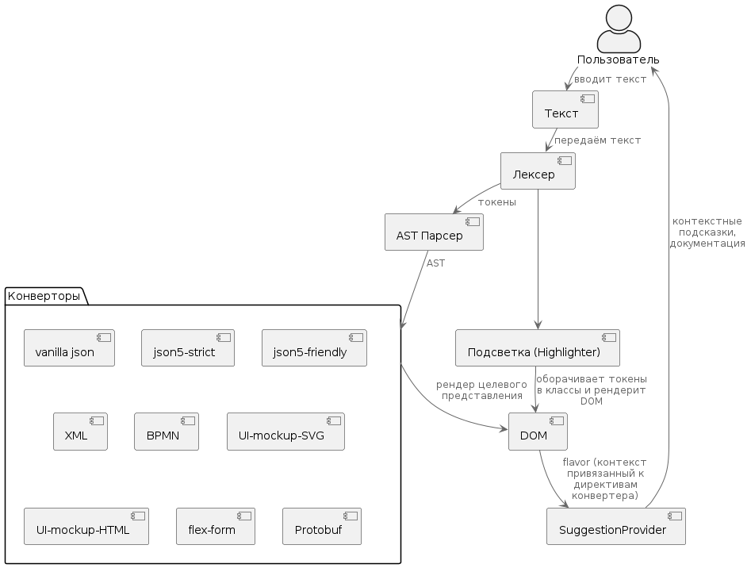
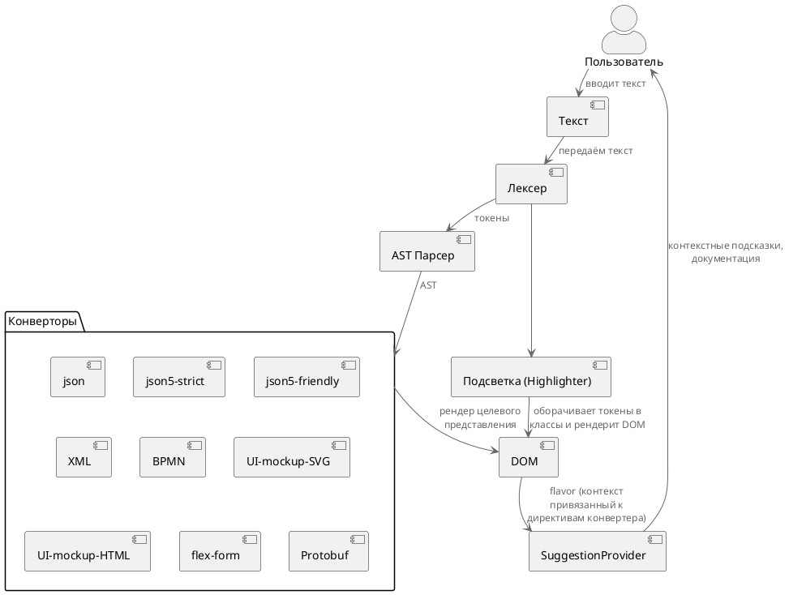
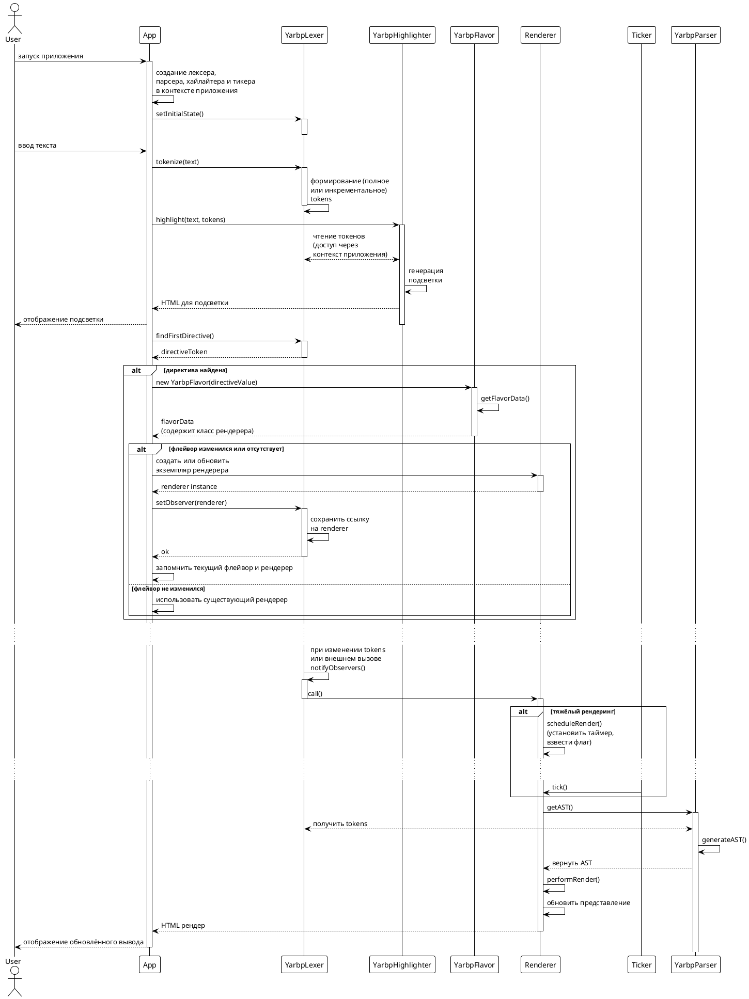

<div align="center">

<h1>Язык разметки для быстрого прототипирования (ЯРБП), v2.0</h1>

<p>
  <a href="https://yarbp.tech/"></a>
  
  
  
</p>

<p>
  <a href="#about">Общее описание</a> ·
  <a href="#structure">Структура</a> ·
  <a href="#sandbox">Песочница</a> ·
  <a href="#syntax">Синтаксис</a> ·
  <a href="#converters">Конвертеры</a> ·
  <a href="#architecture">Архитектура</a>
</p>

</div>

## Содержание

- [Идеи и описание](#about)
- [Структура репозитория](#structure)
- [Язык и AST](#language)
  - [Где заканчивается язык](#language)
  - [Узлы AST](#ast)
  - [Поля узла](#ast-fields)
  - [Примеры языка](#examples)
    - [Минимальный документ](#example-minimal)
    - [Объекты, массивы и анонимные значения](#example-tree)
    - [Строки, числа, булевы значения и `null`](#example-values)
    - [Типы, `#id` и комментарии](#example-types-id-comments)
    - [Фрагмент кода](#example-code)
    - [Подстановка по ключу нулевого уровня](#example-substitution)
    - [Макросы](#example-macros)
    - [Сахар: `разбор-сахара`](#example-sugar)
    - [Импорт объекта из файла](#example-import)
    - [Директивы языка](#example-directives)
    - [JSON и XML из одного AST](#example-json-xml)
  - [Конвертеры](#converters)
  - [Синтаксис в PEG](#peg)
- [Подробные примеры конвертеров](converters.md)
- [Реализация](#implementation)
  - [Запуск](#run)
  - [Тесты](#tests)
  - [Архитектура](#architecture)
- [Сообщество](#community)

---

<a id="about"></a>

## Общее описание

**ЯРБП** (Язык Разметки для Быстрого Прототипирования), он же **YARBP**
(Yet Another Rapid Business Prototyping) - это язык разметки для
аналитиков, который легко писать и читать. Сверхкомпактный, дружелюбный к 
русскоязычной раскладке, человекочитаемый.

Его главная задача - быть, простым способом разметить данные и передать их в конвертер,
чтобы автоматически сгенерировать что угодно,
от JSON или XML до BPMN схем и целых приложений.

<a id="ideas"></a>

### Идеи:
- Удобство набора (в том числе при работе в русской раскладке)
- Удобство чтения (минимум спцсимволов, близость к естественному языку)
- Низкий порог входа и плавное погружение. Хотим писать просто - пишем просто, разметка валидна. 
Хотим записать то же самое но более компактно - изучаем фичи.
- Один синтаксис -> одно универсальное AST, совместимое с большинством языков разметки -> множество целевых представлений
- Широкий набор фич для максимально гибкой разметки целевых представлений и разработки:
  - настраиваемые сокращения (синтаксический сахар)
  - ссылки
  - комментарии
  - макросы
  - интерполяция с другими языками
  - импорт ЯРБП из других файлов
  - директивы конвертеров
- Вся семантика на стороне конвертера - язык определяет только структуру, а смысл придаёт целевой конвертер.

### Итого

ЯРБП будет полезен вам если вы:
- используете docs-as-code
- хотите использвоать ИИ для генерации артефактов и приложений
- пишете много разметки руками на JSON / XML / Protobuf и т.п. и устали от набора спецсимволов
- хотите сделать свой DSL
- не хотите отвлекаться на "рисование" пока описываете UI / бизнес-процесс

## Песочница
Песочница с актуальной версией:
https://yarbp.tech/

<a id="structure"></a>
## Структура репозитория

```text
src/                    рантайм редактора
  index.html            точка входа
  preview/host.html     страница-хост предпросмотра формы ТСД
  css/ fonts/ static/   оформление, шрифты, иконки
  js/                   см. src/js/README.md

notes/                  материалы вне рантайма
  cases/                входные кейсы golden-тестов
  design/               макеты, схемы, скриншоты
  examples/             примеры, не встроенные в редактор

tests/                  браузерные и golden-тесты
tools/                  утилиты командной строки
converters.md           подробные примеры конвертеров (приложение к README)
```

Подробная карта JavaScript-модулей — в `src/js/README.md`.
Конвертеры живут в `src/js/converters/<id>/`; контракт нового конвертера —
`src/js/converters/README.md`.

<a id="sandbox"></a>

---
<a id="language"></a>
<a id="spec"></a>
<a id="syntax"></a>

## Язык и AST

### Где заканчивается язык

ЯРБП — это язык описания структуры данных. В репозитории есть редактор,
конвертеры, тесты и инструменты, но этот README — про сам язык и его AST.
Язык заканчивается на AST: лексер, парсер, директивы, макросы, сахар и импорт
описывают дерево. Что означает это дерево, решает уже конвертер.

В поставке есть два канонических конвертера — **JSON** и **XML**. Они
показывают естественную проекцию AST на привычные форматы. Выбрать JSON можно
директивой `! as json` (русский вариант — `! как джейсон`), XML — `! as xml`
(русский вариант — `! как хмл`).

Остальные конвертеры — BPMN, XPM, UI, форма ТСД, OpenAPI, JSON Schema,
Mermaid, Protobuf — вынесены в отдельный документ и в каталоги
`src/js/converters/`. Ссылки — в разделе [Конвертеры](#converters).

AST заметно подробнее JSON: в нём есть позиции, комментарии, директивы,
пользовательские типы и идентификаторы. Поэтому в примерах ниже показан
JSON-результат: он компактнее и знаком большинству читателей. Где JSON
теряет языковую информацию (например, `type`, `id` или комментарии), это
специально оговорено.

<a id="ast"></a>

### Узлы AST

AST — это дерево. В нём есть четыре вида узлов:

| `nodeType` | Что это |
| --- | --- |
| `ROOT` | Корень документа. Всегда один; содержит `children`, а также директивы и комментарии нулевого уровня. |
| `MEANING` | Значение: объект, массив, строка, число, булево, `null` или фрагмент кода. Именно из `MEANING` состоит дерево данных. |
| `COMMENT` | Комментарий. Подтипы: `TODO` (`--?`), `IMPORTANT` (`--!`), `DELETED` (`--/`). |
| `DIRECTIVE` | Директива `! ...`; хранится в массиве `directives` области, а не в `children`. |

`COMMENT` и `DIRECTIVE` — полноценные узлы AST, но не значения дерева.
Комментарии и директивы прикрепляются к ближайшей области (`ROOT` или
объектному/массивному узлу) в полях `comments` и `directives`.

Значения образуют дерево: объект и массив содержат `children`, а листья
(`STRING`, `NUMBER`, `BOOL`, `NULL`, `CODE`) хранят значение в `value`.
У значения без имени (`:`, `..` или анонимный вызов макроса) поле `key`
отсутствует или пустое.

<a id="ast-fields"></a>

### Поля узла

Ниже перечислены поля, которые фактически встречаются в AST. Обязательность
указана для своего вида узла.

| Поле | Где встречается | Что означает |
| --- | --- | --- |
| `nodeType` | все узлы | Обязательно. `ROOT`, `MEANING`, `COMMENT`, `TODO`, `IMPORTANT`, `DELETED` или `DIRECTIVE`. |
| `key` | `MEANING` | Имя значения. Отсутствует у анонимного значения и у `ROOT`. В ключе могут быть `#id` и `:type` — парсер разбирает их в отдельные поля. |
| `id` | `MEANING` | Необязательно. Появляется, если в ключе есть `#id` и не включена директива `! отключить идентификаторы` / `! disable ids`. |
| `valueType` | `MEANING` | Обязательно. `STRING`, `NUMBER`, `BOOL`, `NULL`, `OBJECT`, `ARRAY` или `CODE`. |
| `value` | `MEANING`, `COMMENT`, `DIRECTIVE` | Значение листа, сырой текст `CODE`, текст комментария/директивы. У объекта может хранить сахар (`ключ = значение`) до его разворачивания. Если у контейнера есть `children`, содержимое задают они. |
| `children` | `ROOT`, `OBJECT`, `ARRAY` | Упорядоченный массив вложенных `MEANING`. У листьев обычно отсутствует. Комментарии и директивы сюда не попадают. |
| `language` | `CODE` | Язык фрагмента из info-строки fence. Если язык не указан — `null`. |
| `type` | `MEANING` | Необязательно. Пользовательский тип после `:` в ключе (`поле:целое`). Язык его не проверяет; смысл задаёт конвертер. |
| `prefix` | `MEANING`, `DIRECTIVE` | Синтаксический префикс: `''` у ключа без префикса, `.` у атрибута, `:` у объекта, `..` у массива, `!` у директивы. |
| `position` | `MEANING`, `COMMENT`, `DIRECTIVE` | `{ start, end }` — смещения в исходном тексте (нумерация с нуля, `end` — за последним символом). У `ROOT` обычно отсутствует; у синтетических узлов сахара/импорта позиция копируется. |
| `directives` | `ROOT` и области | Необязательный массив узлов `DIRECTIVE`, встреченных в этой области. |
| `comments` | `ROOT` и области | Необязательный массив узлов-комментариев этой области. |

Служебный маркер `__macroExpanded` может появляться у узлов после раскрытия
макроса. Это деталь реализации, а не языковое поле; конвертерам он не нужен.

Ключ `key` не является «сырой строкой» для конвертера: `#id` уже лежит в
`id`, а `:type` — в `type`. Если идентификаторы отключены директивой, `#`
остаётся частью `key`, и поля `id` у узлов нет.

<a id="examples"></a>

### Примеры языка

Примеры идут от простого к сложному. Входной текст — ЯРБП, ниже — результат
`! as json`; директива в JSON не попадает, потому что это метаданные AST.

<a id="example-minimal"></a>

#### 1. Минимальный документ

```yarbp
! as json
:
  .order_id 12345
  .status "new"
  .is_active yes
  .total 1299.99
  .deleted null
```

```json
{
  "order_id": 12345,
  "status": "new",
  "is_active": true,
  "total": 1299.99,
  "deleted": null
}
```

`:` объявляет корневой анонимный объект. Точка перед ключом делает его
примитивным полем. Кавычки сохраняют строку, `yes`/`да` и `no`/`нет` дают
булево значение, `null` — null, а число распознаётся по литералу.

<a id="example-tree"></a>

#### 2. Объекты, массивы и анонимные значения

```yarbp
! as json
:
  .order_id 12345
  :client .first_name Jack .last_name White .id '54312'
  ..items
    : .sku ART-001 .price 1299.99
```

```json
{
  "order_id": 12345,
  "client": {
    "first_name": "Jack",
    "last_name": "White",
    "id": "54312"
  },
  "items": [
    {
      "sku": "ART-001",
      "price": 1299.99
    }
  ]
}
```

Префиксы задают вид значения:

| Префикс | Значение |
| --- | --- |
| `.` | примитив (поле объекта) |
| `:` | объект; без ключа — анонимный объект |
| `..` | массив; без ключа — анонимный массив |

`..items` создаёт массив, а `:` внутри него — анонимный объект-элемент.
Одиночные поля можно писать в одной строке: `:client .first_name Jack
.last_name White`. `'54312'` остаётся строкой, а не числом.

<a id="example-values"></a>

#### 3. Строки, числа, булевы значения и `null`

```yarbp
! as json
:
  .title "Многострочный
текст"
  .count 3
  .enabled да
  .removed нет
  .nothing null
  .later
  "значение с новой строки"
```

```json
{
  "title": "Многострочный\nтекст",
  "count": 3,
  "enabled": true,
  "removed": false,
  "nothing": null,
  "later": "значение с новой строки"
}
```

Строка может быть в двойных или одинарных кавычках и переноситься на
несколько строк. Значение примитива можно записать на следующей строке:
`.later` и строка ниже дают то же самое, что `.later "значение..."`.
Bareword без кавычек — тоже строка. Булевы литералы: `yes`, `no`, `да`,
`нет`; `null` — отдельное значение.


<a id="example-types-id-comments"></a>

#### 4. Типы, `#id` и комментарии

```yarbp
! as json
:
  .name:string Заказ --- обычный комментарий
  .count:int32 2 --? TODO
  .old значение --! важно
  .removed значение --/ удалено
```

```json
{
  "name": "Заказ",
  "count": 2,
  "old": "значение",
  "removed": "значение"
}
```

В JSON видны только значения. Тип (`string`, `int32`), комментарии и
семантические пометки остаются в AST:

| Синтаксис | Поле/узел AST |
| --- | --- |
| `.name:string` | `type: "string"` |
| `---` | `nodeType: "COMMENT"` |
| `--?` | `nodeType: "TODO"` |
| `--!` | `nodeType: "IMPORTANT"` |
| `--/` | `nodeType: "DELETED"` |
| `order#order-id:order` | `key: "order"`, `id: "order-id"`, `type: "order"` |

Пример AST-фрагмента для `order#order-id:order` (поля `position` сокращены):

```json
{
  "nodeType": "MEANING",
  "key": "order",
  "id": "order-id",
  "type": "order",
  "valueType": "OBJECT",
  "prefix": "",
  "children": []
}
```

`#id` нужен ссылкам вида `#order-id`. Если в ключе нет половины до или после
`#` (`#итог`, `поле#`), это не id: ключ остаётся как написан. Директива
`! отключить идентификаторы` (или `! disable ids`) отключает выделение `id`
на весь документ, и `#` остаётся в `key`.

Комментарии прикрепляются к ближайшей области в `comments`, а не попадают в
`children`; поэтому JSON-конвертер их не печатает.


<a id="example-code"></a>

#### 5. Фрагмент кода

Фрагмент кода — лексический остров: его содержимое не разбирается как ЯРБП.
Допустимы тройной и одинарный обратный апостроф; язык после открывающего
fence необязателен.

````yarbp
! as json
:
  .handler
    ```bsl
    Сообщить("Привет!");
    ```
````

```json
{
  "handler": "Сообщить(\"Привет!\");"
}
```

В AST это `valueType: "CODE"` с сырым текстом в `value`; язык fence попадает
в `language`, а его отсутствие даёт `language: null`. JSON-конвертер просто
возвращает содержимое строкой. Внутри такого блока подсказки ЯРБП не
работают — это уже другой язык.

<a id="example-substitution"></a>

#### 6. Подстановка по ключу нулевого уровня

`(( имя ))` вне макроса означает «подставь сюда значение ключа `имя` с
нулевым отступом». Ключ-источник после подстановки удаляется из вывода.

```yarbp
! as json
а .б (( с ))
.с д
```

```json
{
  "а": {
    "б": "д"
  }
}
```

Если ключа нет, `(( имя ))` остаётся в тексте, а в строку статуса попадает
диагностика «нет ключа для подстановки». Объект или массив подставляется
содержимым; внутри строки допустимы только примитивы и фрагменты кода.
Макросы используют отдельное пространство имён и описаны ниже.

<a id="example-macros"></a>

#### 7. Макросы

Макрос объявляется как `@имя`; тело — обычные узлы ЯРБП. Вызов
`имя-результата(макрос)` раскрывается в узел с именем результата. Вызов без
скобок оставляет имя макроса. Параметры сопоставляются **только по имени**:
позиционной подстановки нет.

```yarbp
! as json
@item
  .id item-(( item-number ))
  .name (( name ))
items
  item .item-number 1 .name Первый
```

```json
{
  "items": {
    "item": {
      "id": "item-1",
      "name": "Первый"
    }
  }
}
```

`.item-number` и `.name` из вызова подставляются в `(( item-number ))` и
`(( name ))`. Аргумент, который не был подставлен, остаётся полем результата;
если для шортката объекта аргумента нет, появляется диагностика «нет
аргумента». Анонимный вызов `:(макрос)` создаёт объект без ключа:

```yarbp
! as json
@item
  .kind (( kind ))
  .value (( value ))
:(item)
  .kind число
  .value 42
```

```json
{
  "kind": "число",
  "value": "42"
}
```

Макросы раскрываются на уровне парсера: конвертер получает уже готовое
дерево и не знает, что в исходнике был `@item`.

<a id="example-sugar"></a>

#### 8. Сахар: `разбор-сахара`

Сахар — сокращённая запись свойств после `=`. Без директивы значение
остаётся в `value` объекта, а его смысл определяет конвертер. Директива
`! разбор-сахара` заранее описывает, как разложить значение на свойства.

```yarbp
! as json
! разбор-сахара(поле) имя / значение
поле = Товар / 42
```

```json
{
  "поле": {
    "имя": "Товар",
    "значение": 42
  }
}
```

Тег в скобках ограничивает правило ключами `поле`; без тега правило действует
на все ключи. Разделитель задаётся в директиве (`/`, `//`, `,`, `|`);
пробелы вокруг него не важны. Явно заданное свойство важнее сахара. Если
директивы нет, `value` не разворачивается.

<a id="example-import"></a>

#### 9. Импорт объекта из файла

`! импорт` вставляет объект верхнего уровня из другого файла песочницы:

```yarbp
! импорт форма из "Форма ТСД"
```

Имя объекта — один токен; имя файла можно писать без пробелов или в двойных
кавычках. Файл ищется по имени, `slug` или `id`. Макросы и сахар файла-
источника раскрываются до импорта. Неизвестный файл или объект даёт
диагностику; malformed-строка не считается директивой импорта.


<a id="example-directives"></a>

#### 10. Директивы языка

Директива начинается с `!` и живёт в AST как отдельный узел `DIRECTIVE`.
Часть директив — языковые, часть передаётся конвертерам:

| Директива | Что делает |
| --- | --- |
| `! as json` / `! как джейсон` | выбирает JSON-конвертер |
| `! as xml` / `! как хмл` | выбирает XML-конвертер |
| `! импорт <объект> из <файл>` | вставляет объект из другого файла |
| `! разбор-сахара(<тег>) имя / имя` | раскладывает `value` объекта в свойства |
| `! отключить идентификаторы` / `! disable ids` | оставляет `#id` в ключе, не создавая поле `id` |

Любая другая директива тоже сохраняется в AST: её смысл определяет
конвертер. В JSON-выводе директивы не появляются — это метаданные дерева.
Директивы должны стоять на нулевом отступе, если они меняют документ целиком
(`! отключить идентификаторы`, `! разбор-сахара`); директивы конвертера
читаются из первой подходящей директивы документа.

<a id="example-json-xml"></a>

#### 11. Один документ — две канонические проекции

```yarbp
! as xml
order
  .id 42
  ..line
    .sku A-1
```

```xml
<order id="42">
  <line sku="A-1"></line>
</order>
```

Тот же AST можно отдать JSON-конвертеру, заменив директиву на `! as json`.
Язык при этом не меняется: меняется только правило обхода дерева.

<a id="converters"></a>

### Конвертеры

Язык заканчивается на AST; конвертеры — отдельные каталоги
`src/js/converters/<id>/`. Канонические JSON и XML описаны выше; остальные
конвертеры имеют собственные правила и примеры:

- [Подробные примеры конвертеров](converters.md) — BPMN, OpenAPI, JSON Schema,
  Mermaid, форма ТСД, UI-форма, XPM, Protobuf и прикладные примеры.
- [Контракт конвертера](src/js/converters/README.md) — как добавить свой
  конвертер и не нарушить AST.
- [README формы ТСД](src/js/converters/flexforms/README.md) и
  [README UI-формы](src/js/converters/ui/README.md).

| Директива | Конвертер | Где смотреть |
| --- | --- | --- |
| `! as json` / `! как джейсон` | JSON | `src/js/converters/json/` |
| `! as xml` / `! как хмл` | XML | `src/js/converters/xml/` |
| `! as ast` / `! как аст` | AST для отладки | `src/js/converters/ast/` |
| `! as lexer` / `! как лексер` | токены лексера | `src/js/converters/lexer/` |
| `! as proto` / `! как прото` | Protobuf | `src/js/converters/protobuf/` |
| `! as bpmn` / `! как бпмн` | BPMN 2.0 | `converters.md#bpmn` |
| `! as xpm` / `! как кпо` | карта процесса-опыта | `converters.md#xpm` |
| `! as ui` / `! как форма` | UI-макет | `converters.md#ui-generator-guide` |
| `! as flexforms` / `! как форма-тсд` | форма ТСД | `converters.md#tsd` |
| `! as openapi` / `! как openapi` | OpenAPI 3.0 | `converters.md#openapi` |
| `! as json-schema` / `! как схема` | JSON Schema | `converters.md#json-schema` |
| `! as mermaid` / `! как мермейд` | Mermaid | `converters.md#mermaid` |

Выбор конвертера — единственное, что связывает язык с конкретным выходным
форматом. Всё, что находится в `children`, `directives` и `comments` дерева,
конвертер получает уже после раскрытия макросов, подстановок, сахара и
импорта.

<a id="peg"></a>

### Синтаксис в PEG

Это эскиз грамматики, а не источник истины: фактическое поведение задают
лексер, парсер и тесты. Полная спецификация ниже полезна при добавлении
новой конструкции.

````peg
; ============================================================
; ЯРБП v2.0 - PEG спецификация
; ============================================================

документ              <- элемент*
элемент               <- отступ? выражение? комментарий? CRLF
выражение             <- директива / узел+

комментарий           <- префикс-комментария [^\n]*
директива             <- префикс-директивы S? имя-директивы S значение-директивы
узел                  <- сложный-узел / примитивный-узел

сложный-узел          <- объект / массив

объект                <- ( ( префикс-объекта? ключ ) / ( префикс-объекта ключ? ) )
                         ( ":" тип )? ( S+ ( объект / массив / примитивный-узел / shorthand ) )*
массив                <- ( ( префикс-массива? ключ ) / ( префикс-массива ключ? ) )
                         ( ":" тип )? ( S+ ( объект / массив / значение ) )*

shorthand             <- ключ S* "=" S* значение
примитивный-узел      <- префикс-примитива ключ
                         ( " " значение / S* CRLF S* значение )?
примитив              <- строка / число / булево / null
строка                <- ( токен S? )+ / строка-в-кавычках

; --- Семантические определения ---
тип                   <- токен
ключ                  <- токен ( "#" идентификатор )?
идентификатор         <- токен
имя-директивы         <- токен
значение-директивы    <- ( токен S )*
значение              <- примитив / код-блок

; --- Префиксы ---
префикс-комментария <- "---" / "--?" / "--!" / "--/"
префикс-директивы   <- "!"
префикс-объекта     <- ":"
префикс-массива     <- ".."
префикс-примитива   <- "."

; --- Базовые определения ---
отступ            <- [ " " ]+
токен             <- ( !"--" !S . )+
строка-в-кавычках <- "\"" [^"]* "\"" / "'" [^']* "'" / "(" [^)]* ")"
число             <- "-"? [0-9]+ ("." [0-9]+)? ([eE] "-"? [0-9]+)?
булево            <- "true" / "false" / "yes" / "no" / "да" / "нет"
null              <- "null"

; --- Фрагмент кода ---
код-блок          <- код-блок-3 / код-блок-1
код-блок-3        <- "```" [^\n]* CRLF ( !"```" . )* "```"
код-блок-1        <- "`" [^\n]* CRLF ( !( CRLF [ \t]* "`" ) . )* CRLF [ \t]* "`"

S                 <- [ \t\n\r]
CRLF              <- [\n\r]
````

---


<a id="implementation"></a>

## Реализация

<a id="run"></a>

### Запуск

Приложение статическое: сборки нет, зависимостей нет. Достаточно раздать
каталог `src/` любым HTTP-сервером. Открывать `src/index.html` двойным
щелчком нельзя — редактор целиком на ES-модулях, а с `file://` браузер их
не загружает.

```powershell
python -m http.server 8000 --directory src
# затем http://localhost:8000/
```

<a id="tests"></a>

### Тесты

Раннеры на Python (только стандартная библиотека), браузерные проверки — в
headless Chrome/Edge. Node не нужен.

```powershell
python tests/lexer/run_tests.py       # 46 golden-кейсов лексера/парсера
python tests/features/run_tests.py    # подстановка, код-блоки, новая строка, подсветка, UI-рантайм
python tests/ui-parity/run_tests.py   # UI-форма буква-в-букву как в notes/design/target.html
python tests/security/run_tests.py    # регрессии безопасности (экранирование)
python tests/files/run_tests.py       # localStorage и экспорт/импорт файлов
python tests/autocomplete/run_tests.py # словарь подсказок
python tests/converters/run_tests.py  # smoke: json, xml, proto, ui, bpmn, форма
python tests/flexforms/run_tests.py   # флейвор «форма-ТСД»
python tests/perf/run_tests.py        # бюджеты разбора и подсветки
```

У `tests/flexforms` внешних зависимостей нет: только Python 3 и Chrome/Edge для
браузерного дыма. Генерация ассетов из внешнего `редизайн/`, сравнение с ним и
JS-прогоны через `quickjs` удалены — проект и тесты живут на чистом JS и
стандартной библиотеке Python.

<a id="architecture"></a>

### Архитектура

#### Целевая схема компонентов



#### Сиквенс текущей реализации редактора


#### Структура конвертеров

Конвертер — это самостоятельный каталог `src/js/converters/<id>/`:

```text
converters/<id>/
  index.js       паспорт: id, names, renderer / loadRenderer, suggestions
  converter.js   AST → целевой формат (без DOM и мутации AST)
  renderer.js    вывод в панель результата (наследует shared/renderer.js)
  suggestions.js словарь подсказок (если нужен)
  README.md      ограничения и особенности формата
```

Общий код, который используют два и более конвертера, лежит только в
`src/js/converters/shared/`; конвертер не импортирует соседний каталог.
Реестр `converters/registry.js` строит карту «имя директивы → конвертер»,
`YarbpFlavor` и `prefetchFlavors` — его публичный API.

Полный контракт, правила `shared/`, чек-лист нового конвертера и таблица
переезда старых путей: [`src/js/converters/README.md`](src/js/converters/README.md).


<details>
<summary>Исходники PlantUML</summary>





</details>

---

<a id="community"></a>

## Сообщество

- [Telegram-канал](https://t.me/analyst_writes_things) - новости проекта
