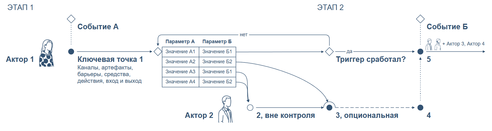
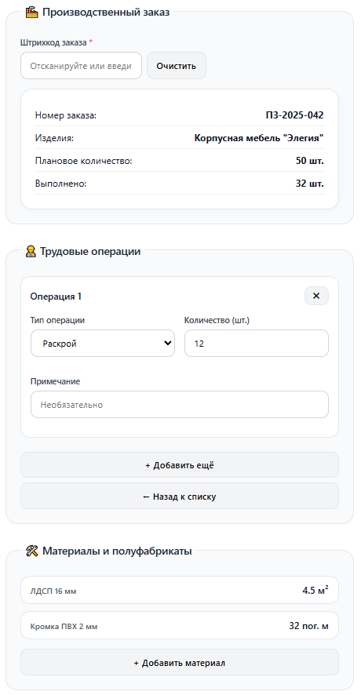
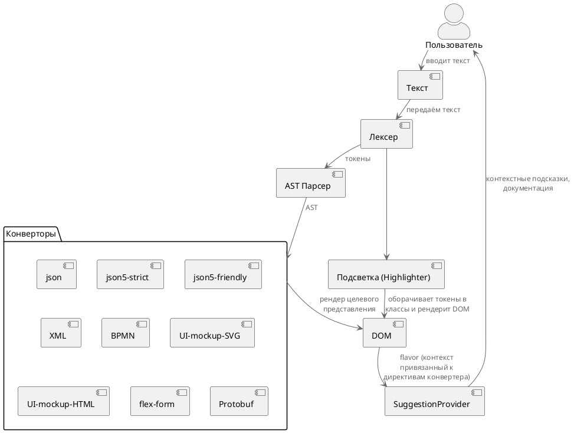
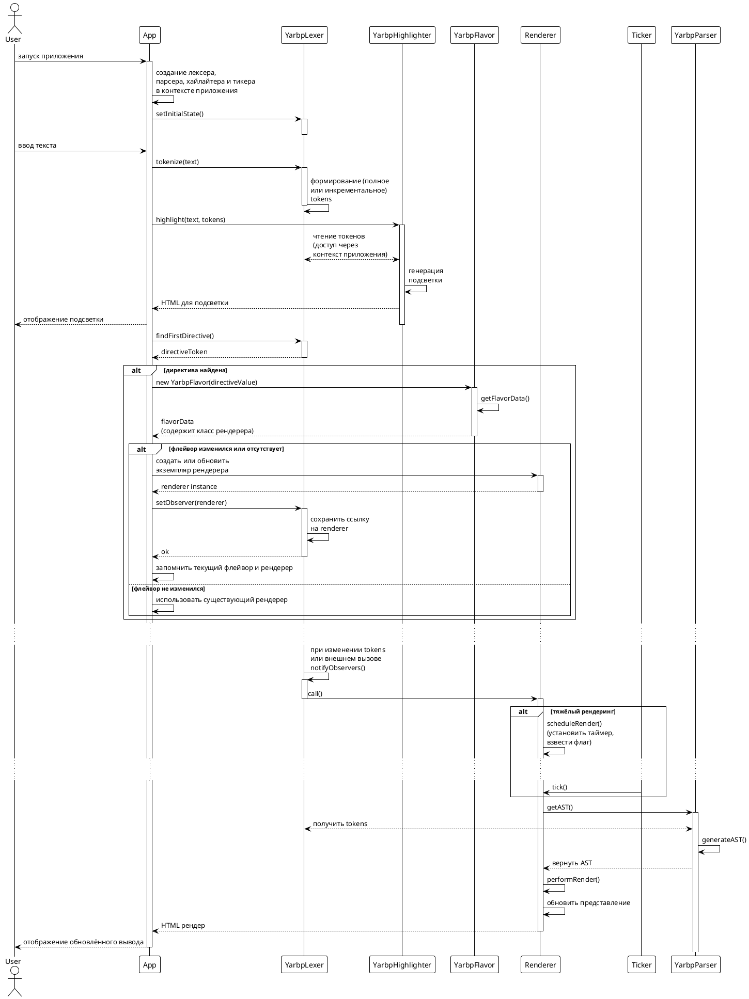

<div align="center">

<h1>Язык разметки для быстрого прототипирования (ЯРБП), v2.0</h1>

<p>
  <a href="https://yarbp.tech/"></a>
  
  
  
</p>

<p>
  <a href="#about">Общее описание</a> ·
  <a href="#structure">Структура</a> ·
  <a href="#sandbox">Песочница</a> ·
  <a href="#syntax">Синтаксис</a> ·
  <a href="#converters">Конвертеры</a> ·
  <a href="#architecture">Архитектура</a>
</p>

</div>

## Содержание

- [Идеи и описание](#about)
- [Структура репозитория](#structure)
- [Синтаксис на примерах](#spec)
  - [Базовый пример](#simple-example)
  - [Расширенный пример](#advanced-example)
  - [Типизация и комментарии](#typed-comments)
  - [Идентификатор узла `#id`](#node-id)
  - [Макросы](#macros)
  - [Подстановка по ключу нулевого уровня](#substitution)
  - [Фрагмент кода](#code-block)
  - [Значение с новой строки](#next-line-value)
  - [Сахар и дизайн AST](#sugar-ast)
  - [Импорт объекта из файла](#import-directive)
- [Синтаксис в PEG](#peg)
- [Прикладные конвертеры](#converters)
  - [BPMN](#bpmn)
  - [OpenAPI](#openapi)
  - [JSON Schema](#json-schema)
  - [Mermaid](#mermaid)
  - [ТСД](#tsd)
  - [Карта процесса-опыта](#xpm)
  - [Прикладной пример](#applied-example)
  - [Гайд по генератору форм](#ui-generator-guide)

- [Реализация](#implementation)
  - [Архитектура](#architecture)
- [Сообщество](#community)

---

<a id="about"></a>

## Общее описание

**ЯРБП** (Язык Разметки для Быстрого Прототипирования), он же **YARBP**
(Yet Another Rapid Business Prototyping) - это язык разметки для
аналитиков, который легко писать и читать. Сверхкомпактный, дружелюбный к 
русскоязычной раскладке, человекочитаемый.

Его главная задача - быть, простым способом разметить данные и передать их в конвертер,
чтобы автоматически сгенерировать что угодно,
от JSON или XML до BPMN схем и целых приложений.

<a id="ideas"></a>

### Идеи:
- Удобство набора (в том числе при работе в русской раскладке)
- Удобство чтения (минимум спцсимволов, близость к естественному языку)
- Низкий порог входа и плавное погружение. Хотим писать просто - пишем просто, разметка валидна. 
Хотим записать то же самое но более компактно - изучаем фичи.
- Один синтаксис -> одно универсальное AST, совместимое с большинством языков разметки -> множество целевых представлений
- Широкий набор фич для максимально гибкой разметки целевых представлений и разработки:
  - настраиваемые сокращения (синтаксический сахар)
  - ссылки
  - комментарии
  - макросы
  - интерполяция с другими языками
  - импорт ЯРБП из других файлов
  - директивы конвертеров
- Вся семантика на стороне конвертера - язык определяет только структуру, а смысл придаёт целевой конвертер.

### Итого

ЯРБП будет полезен вам если вы:
- используете docs-as-code
- хотите использвоать ИИ для генерации артефактов и приложений
- пишете много разметки руками на JSON / XML / Protobuf и т.п. и устали от набора спецсимволов
- хотите сделать свой DSL
- не хотите отвлекаться на "рисование" пока описываете UI / бизнес-процесс

## Песочница
Песочница с актуальной версией:
https://yarbp.tech/

<a id="structure"></a>
## Структура репозитория

```text
src/                    рантайм редактора
  index.html            точка входа
  preview/host.html     страница-хост предпросмотра формы ТСД
  css/ fonts/ static/   оформление, шрифты, иконки
  js/                   см. src/js/README.md

notes/                  материалы вне рантайма
  cases/                входные кейсы golden-тестов
  design/               макеты, схемы, скриншоты
  examples/             примеры, не встроенные в редактор

tests/                  браузерные и golden-тесты
tools/                  утилиты командной строки
```

Подробная карта JavaScript-модулей — в `src/js/README.md`.
Конвертеры живут в `src/js/converters/<id>/`; контракт нового конвертера —
`src/js/converters/README.md`.

<a id="sandbox"></a>

<a id="spec"></a>

## Спецификация

<a id="syntax"></a>

### Синтаксис

<a id="advanced-example"></a>

#### Расширенный пример

```yarbp
! as json
:
  .order_id 12345
  .status "new"
  .is_active yes
  :client .first_name Jack .last_name White .id '54312'
  ..items
    : .sku ART-001 .price 1299.99
```

Лидирующие символы указывают на тип ключа.
В предыдущем примере типы ключей выводились автоматически, но их можно указывать явно.
Доступные типы ключей:

| Префикс | Тип ключа |
| :---: | --- |
| `.` | лидирующая точка -> ключ примитивного значения (атрибут объекта) |
| `:` | лидирующее двоеточие -> ключ объекта |
| `..` | лидирующая двойная точка -> ключ массива |

Указание типа ключа без значения ключа объявляет анонимное значение (значение без имени),
см. ниже как сконвертировалось в этом примере корневой объект и объект внутри "items"

Рендер:

```json
{
  "order_id": 12345,
  "status": "new",
  "is_active": true,
  "client": {
    "first_name": "Jack",
    "last_name": "White",
    "id": "54312"
  },
  "items": [
    {
      "sku": "ART-001",
      "price": 1299.99
    }
  ]
}
```

<a id="typed-comments"></a>

#### Пример с типизацей и комментариями

```yarbp
! as proto
Order
  .order_number:string --- comment
  .date:string --- comment
  ..items
    Product .name:string
      .size:enum UNSPECIFIED SMALL MEDIUM LARGE
    .position:int32
```

ЯРБП поддерживает комментарии и типизацию значений.
Типы указываются после ключей через двоеточие как ```ключ:тип```.

Комментарии начинаются с ```---```.

Рендер:

```proto
message Order {
  string order_number = 1;  // comment
  string date = 2;          // comment
  repeated Item items = 3;
}

message Product {
  string name = 1;
  Size size = 2;
}

message Item {
  Product Product = 1;
  int32 position = 2;
}

enum Size {
  UNSPECIFIED = 0;
  SMALL = 1;
  MEDIUM = 2;
  LARGE = 3;
}
```

<a id="node-id"></a>

#### Идентификатор узла `#id`

Решётка в ключе задаёт **id узла** — по нему элементы находят свойства,
которые ссылаются на идентификатор (`.навигация`, `.проверить`,
`.приемник`):

```yarbp
! как аст
группа#order:форма
  поле#итог:целое
```

Парсер разбирает такое выражение в **один** узел: ключ, id и тип — три
отдельных поля AST.

```json
{
  "nodeType": "MEANING",
  "key": "поле",
  "id": "итог",
  "type": "целое",
  "prefix": ".",
  "valueType": "NUMBER",
  "value": 0
}
```

Правила:

- id — всё после первого `#` в ключе, ключ — всё до него; тип по-прежнему
  отделяется последним `:` и попадает в поле `type`;
- пустые половины (`#итог`, `поле#`) идентификатором не считаются: ключ
  остаётся как написан;
- id не становится частью имени ключа в конвертерах: `! as json` увидит
  `поле`, а не `поле#итог`;
- `#` в **значении** (`.навигация #табы.список`) — обычный текст, а не id:
  поле `id` заполняется только из ключа.

Разбор можно выключить языковой директивой — тогда `#id` останется частью
ключа, как в ранних документах:

```yarbp
! отключить идентификаторы
поле#итог значение
```

Англоязычный аналог — `! disable ids`. Директива действует на весь документ,
принимается только на нулевом отступе и выключает поле `id` у всех узлов.
В редакторе `#id` подсвечивается тем же цветом, что ссылки и объявления
макросов: это тоже ссылка. Жирность ключа id не наследует (у ключа объекта
она своя), поэтому `#итог` визуально отделён от имени ключа.

<a id="macros"></a>

#### Макросы.

Макросы в ЯРБП объявляются лидирующим ```@```. Используются для того чтобы минимизировать написание повторяющегося кода.
Раскрываются на уровне парсера подстановкой, т.о конвертору макросы уже недоступны, AST подается раскрытым.

Определение задаётся как `@a`. Вызов: `имя(a)` — в скобках имя макроса, перед скобками имя результата. `xx(a)` раскроется в узел `xx`, `yy(a)` — в `yy`. Вызов без скобок (`a`) оставляет имя `a`. Пробелы внутри `имя(a)` не допускаются: вызов должен быть одним токеном, иначе разметка ломается.

Параметры макроса сопоставляются **только по имени**: `(( имя ))` получает аргумент `.имя` (или `..имя`) из вызова. Позиционного сопоставления нет: порядок аргументов не важен, а первый попавшийся аргумент не подставляется. Аргументы, которые не были подставлены, остаются полями результата. Если для шортката объекта аргумента нет, значение снимается, а в диагностику попадает «нет аргумента». Анонимный вызов `:(макро)` даёт объект без ключа — в массиве или в корне он становится безымянным элементом.

Если значение объекта задаётся сахаром, имя в теле должно совпадать с именем аргумента: `@м = (( свойства-строкой ))` и `.свойства-строкой 1 / 'bool' / да / null`. Запись `@м = (( имя ))` с аргументом `.свойства-строкой` не сработает: это разные имена.

Пример:

```yarbp
! as xml

@item
  .id item-(( item-number ))
  ..content
    (( variable-content ))
    extra-content .prop-1 (( prop-1 )) .prop-2 (( prop-2 ))
  controller .name controller-(( item-number ))

items
  item .item-number 1 .prop-1 1 .prop-2 2
    ..variable-content
      sub-item .id 1
  item .item-number 2 .prop-1 3 .prop-2 4
    ..variable-content
      sub-item .id 1
      sub-item .id 2
  item .item-number 3 .prop-1 5 .prop-2 6
    ..variable-content
```

Рендер:

```xml
<items>
  <item id="item-1">
    <content>
      <sub-item id="1"/>
      <extra-content prop-1="1" prop-2="2"/>
    </content>
    <controller name="controller-1"/>
  </item>
  <item id="item-2">
    <content>
      <sub-item id="1"/>
      <sub-item id="2"/>
      <extra-content prop-1="3" prop-2="4"/>
    </content>
    <controller name="controller-2"/>
  </item>
  <item id="item-3">
    <content>
      <extra-content prop-1="5" prop-2="6"/>
    </content>
    <controller name="controller-3"/>
  </item>
</items>
```

<a id="substitution"></a>

#### Подстановка по ключу нулевого уровня

Вне макроса `(( имя ))` означает «подставь сюда содержимое ключа `имя` с нулевым
отступом». Ключ-источник убирается из вывода: он нужен только для подстановки.
Если имя встречается несколько раз, подстановка выполняется во всех местах, а
ключ удаляется один раз.

```yarbp
а .б (( с ))
.с д
```

Эквивалентно:

```yarbp
а .б д
```

- если ключа с таким именем нет, `(( имя ))` остаётся как есть, а в строке
  статуса появляется диагностика «нет ключа для подстановки»;
- объект или массив подставляется содержимым: дети переходят в целевой узел;
  внутри строки допустимы только примитивы и фрагменты кода;
- макросы работают как раньше: в теле `@...` имя резолвится из аргументов
  вызова, а не из ключей документа.

<a id="code-block"></a>

#### Фрагмент кода

Фрагмент кода — лексический остров: между открывающим и закрывающим fence
текст не парсится, отступы сохраняются. Допустимы тройной и одинарный
обратный апостроф; язык опционален и берётся из первого слова после
открывающего fence.

````yarbp
.обработчик-1
```bsl
// Комментарий
Процедура Тест()
КонецПроцедуры
```

.обработчик-2
`js
function test() { return 1; }
`
````

В AST это примитив:

```json
{
  "nodeType": "MEANING",
  "key": "обработчик-1",
  "prefix": ".",
  "valueType": "CODE",
  "language": "bsl",
  "value": "// Комментарий\nПроцедура Тест()\nКонецПроцедуры"
}
```

- без языка `language` равен `null`, встроенная подсветка не запускается;
- отступ самого fence снимается с содержимого, внутренние отступы кода
  сохраняются относительно fence; табы внутри острова не нормализуются;
- фрагмент можно передать параметром макроса;
- внутри фрагмента кода меню автодополнения ЯРБП не вызывается (включая Alt):
  это чужой язык;
- незакрытый блок — ошибка «незакрытый фрагмент кода».

Подсветка содержимого встроенных языков (BSL/1С, JS/TS, SQL, JSON) выполняется
отдельным отложенным проходом через 150 мс после подсветки ЯРБП. Границы и
язык рисует основной хайлайтер; проход меняет только содержимое блока, поэтому
курсор и выделение не сбиваются. Без языка проход не запускается.

Содержимое BSL/1С красится в традиционную схему конфигуратора 1С: ключевые
слова и операторы — красные, идентификаторы — синие, строки/числа/даты —
чёрные, комментарии — зелёные, препроцессор и аннотации — коричневые. Точные
цвета и источник — `src/js/classes/highlighters/README.md`.

Ссылки и макросы подсвечиваются отдельным цветом, но только когда они
фактически сработали при сборке AST: `(( имя ))` — если ключ с таким именем
найден, ключ верхнего уровня — если его подставили в такую ссылку,
`@имя-макроса` — всегда, `(( параметр ))` внутри макроса — если хоть один
вызов передаёт этот параметр. Тем же цветом
подсвечивается `#id` в ключе: это тоже ссылка на узел, к ней адресуются
`.навигация`, `.проверить` и `.приемник`. Жирность ключа id не наследует:
ключ объекта — жирный, а ссылка — нет.
Светлая тема — оранжевый `#98542B`, тёмная — тёплый золотой `#F0C674`.
Правила — `src/js/classes/highlighters/linkRanges.js`.

<a id="next-line-value"></a>

#### Значение с новой строки

Значение примитивного ключа можно записать на следующей строке:

````yarbp
а .б (( с ))
.с
"
Многострочный
Текст
"
````

Эквивалентно:

````yarbp
а .б (( с ))
.с "Многострочный
Текст"
````

Работают строки в любых кавычках, многострочные строки, фрагмент кода, число,
`yes`/`no`/`да`/`нет`, `null`. Bareword на следующей строке остаётся новым
узлом, а не значением. Если значения нет, AST сохраняет прежнее пустое значение
для совместимости, но в строке статуса появляется диагностика «ожидалось
значение». Позиция значения в AST указывает на строку значения, а не на ключ.

<a id="sugar-ast"></a>

#### Сахар и дизайн AST.

Узел AST — плоский набор полей: `nodeType`, `key`, `id`, `value` или
`children`, `valueType`, `type` (пользовательский вид после `:`), `language`,
`prefix`, `position`, `directives`, `comments`. Части ключа разбирает парсер:
`#id` уходит в поле `id` (см. [Идентификатор узла `#id`](#node-id)), тип —
в `type`.

Сахар — это сокращённое объявление свойств после знака `=`. В текущем
парсере значение хранится в поле `value` объектного узла, а не в отдельном
узле `shorthand`.

```yarbp
! как аст
поле-формы:дата = Дата начала
```

```json
{
  "nodeType": "MEANING",
  "key": "поле-формы",
  "valueType": "OBJECT",
  "prefix": "",
  "type": "дата",
  "value": "Дата начала"
}
```

Что означает `= Дата начала`, решает конвертер. Директива
`! разбор-сахара` задаёт имена свойств и разделитель, после чего сахар
разворачивается в AST в явные свойства (прежнее имя директивы —
`типизация-сахара`, оно больше не поддерживается):

```yarbp
! как аст
! разбор-сахара(поле-формы) лэйбл / плейсхолдер
поле-формы:дата = Дата начала / Выберите дату
```

эквивалентно

```yarbp
поле-формы:дата
  .лэйбл Дата начала
  .плейсхолдер Выберите дату
```

Тег можно не указывать — тогда правило применяется ко всем тегам:

```yarbp
! разбор-сахара имя / ид
поле = Товар / f1
опция = Розница / shop-1
```

Здесь `поле` станет `.имя Товар` + `.ид f1`, а `опция` — `.имя Розница` +
`.ид shop-1`. Если для тега есть отдельное правило, оно важнее глобального.

Правила:

- тег сравнивается по ключу: `#id` и `:вид` уже вынесены парсером в поля
  `id` и `type` (при `! отключить идентификаторы` `#` остаётся в ключе и
  отрезается при сравнении);
- без `(<тег>)` правило действует на все теги; частное правило важнее;
- разделитель (`/`, `//`, `,`, `|`) задаётся в директиве; пробелы вокруг него
  не важны, а ведущий слэш значения (`/orders / Список`) сохраняется;
- пустые сегменты свойств не создают;
- явное свойство важнее сахара;
- без директивы `value` остаётся как раньше — старые документы работают.

Строгий формат: если шапка директивы не совпала (пустые скобки, разные
разделители, имена с пробелами), строка не считается директивой и не даёт
диагностики.

<a id="import-directive"></a>

#### Импорт объекта из файла

`! импорт` вставляет в текущий документ объект верхнего уровня из другого
файла, доступного в основном интерфейсе (папка «Примеры» и файлы
пользователя):

```yarbp
! импорт форма из tsd-form
! импорт форма из "Форма ТСД"
```

- имя объекта — один токен без пробелов;
- имя файла — без пробелов или в двойных кавычках (кавычки обязательны,
  если есть пробелы);
- файл ищется по имени, `slug` или `id` без учёта регистра;
- макросы и сахар файла-источника раскрываются до импорта;
- если строка не совпала с форматом, это не директива импорта: она молча
  игнорируется, чтобы не ломать произвольные директивы конвертеров;
- распознанная директива с неизвестным файлом/объектом показывает
  диагностику; дубль ключа в текущем документе не перезаписывается.

Импортированный объект помечается `origin` (файл, объект, исходная
позиция), а его верхняя позиция указывает на директиву.

<a id="xpm"></a>

#### Рендер карты процесса-опыта (КПО)

Один из конвертеров ЯРБП превращает текстовое описание бизнес-процесса
в визуальную **карту процесса-опыта**: дорожки, участники, ключевые точки,
события, таблицы решений и связи между ними.

> **Карта процесса-опыта** - метод визуализации любого хозяйственного процесса
> с акцентом на человеке, но при этом с учётом обеспечивающих его
> технических аспектов. Схема согласует пользовательский опыт и бизнес-процессы
> в единой многослойной карте: акторы и агенты, ключевые точки, линии тока,
> линии взаимодействий, триггеры, события и аннотационные блоки.
>
> - [Описание метода](https://ashapiro.ru/xpm) · [База знаний на GitHub](https://github.com/Byndyusoft/xp-mapping)

Пример разметки:

```yarbp
! как КПО

дорожка

  разделитель = ЭТАП 1
  событие = Событие А
  пусто
  пусто
  разделитель = ЭТАП 2
  событие = Событие Б

участник = Актор 1 .картинка женщина-яркая-одежда

  точка = Ключевая точка 1
    ..связи ->
    ..аннотации
      Каналы, артефакты,
      барьеры, средства,
      действия, вход и выход

  точка
    .ид триггер-1-2
    .тип -<>
    таблица-решений
      ..шапка "Параметр А" "Параметр Б"
      ..правила
        :
          ..параметры "Значение А1" "Значение Б1"
          .результат точка-1-4
        :
          ..параметры "Значение А2" "Значение Б2"
          .результат точка-2-4
        :
          ..параметры "Значение А3" "Значение Б1"
          .результат точка-2-3
        :
          ..параметры "Значение А4" "Значение Б2"
          .результат точка-2-3

  пусто

  точка = Триггер сработал?
    .ид точка-1-4
    .тип -<>
    ..связи [да]-> нет нет [нет]->триггер-1-2

  точка = 5
    появление .аннотация + Актор 3, Актор 4
      ..участники
        участник .картинка производство
        участник .картинка оператор
    ..связи -> <..

участник = Актор 2 .картинка мужчина-менеджер

    пусто

    пусто

    точка = 2, вне контроля
      .ид точка-2-3
      .тип -о
      ..связи ->

    точка = 3, опциональная
      .тип -(
      .ид точка-2-4
      ..связи -->

    точка = 4
```

Рендер:



Идентификаторы иконок для использвоания в конвертере КПО:

| Идентификатор | Идентификатор | Идентификатор |
| --- | --- | --- |
| `мужчина` | `женщина` | `повар` |
| `производство` | `мужчина-в-очках` | `женщина-в-очках` |
| `в-каске` | `ии` | `робот` |
| `мужчина-менеджер` | `женщина-менеджер` | `мужчина-яркая-одежда` |
| `женщина-яркая-одежда` | `оператор` | |

<a id="applied-example"></a>

#### Прикладной пример

<details>

<summary>Если не готовы погружаться в детали - проходите дальше</summary>

Это целевой пример использования ЯРБП для генератора форм. Используются макросы,
директивы конвертора (рендерера формы) предоставляющие типизацию сахара.

> Как эта разметка превращается в работающую форму и какие действия уже
> поддерживаются: **[Гайд по генератору форм](#ui-generator-guide)**.

Разметка формы:

```yarbp
! как xml
! разбор-сахара(поле)  лэйбл/плейсхолдер/обязательный/постфикс
! разбор-сахара(опция) представление/значение

@ввод-показателей
  группа:плитка =     (( имя-формы ))
    .направление вертикально
    табы .ид          (( ид-табов ))
      таб#список
                      (( контент-списка ))
        кнопка =    + (( имя-кнопки-добавления ))
          .навигация #(( ид-табов )).добавить
      таб#добавить
        группа:плитка
          ..доп-функционал очистить
          надпись =   (( имя-добавляемой-сущности ))
          группа
                      (( поля-формы-ввода ))
          поле = Комментарий / что-то еще?
        кнопка = Добавить
          ..источник #добавить
          ..приемник #список
        кнопка = <- Назад к списку
          .навигация  #(( ид-табов )).список
          .проверить #(( ид-табов )).добавить.количество
          .диалог Очистите введенные данные или перенесите их в отчет / Ок
          .тип_проверки пусто
          .цель_проверки запретить

группа#производственный-отчет:форма
  группа -- левая колонка

    группа:плитка = Производственный заказ
      .направление вертикально
      поле#запрос-заказа:штрихкод = Штрихкод заказа / Отсканируйте бланк заказа / да
        ..доп-функционал очистить
        .хук https://foobar.tech/order
      группа:таблица
        поле:строка =  Номер заказа
        поле:строка =  Изделия
        поле:целое =   Плановое количество / / / шт.
        поле:целое =   Выполнено / / / шт.

    ввод-показателей
      .имя-формы Трудовые операции .имя-добавляемой-сущности Операция
      .ид-табов трудозатраты .имя-кнопки-добавления Добавить операцию
      контент-списка
        группа:набор-соответствий
          :поле#тип-операции
          поле#количество:целое .постфикс шт.
          поле = Комментарий:
      поля-формы-ввода
        поле:выбор = Тип операции
          .тип-данных Справочник.ВидыРаботСотрудников
          опция = Раскрой  / d9d22580-0c9f-11f1-81c8-bc241168061e
          опция = Контроль / f6f35814-12ee-11f1-862c-bc241168061e
          опция = Сборка   / 6bea020c-0297-11f1-86e5-bc241168061e
          опция = Упаковка / 3620c04c-21d8-11f1-8b34-bc241168061e
        поле:число = Количество / Укажите кол-во / *

    ввод-показателей
      .имя-формы Материалы и полуфабрикаты .имя-добавляемой-сущности Материал
      .ид-табов материалы .имя-кнопки-добавления Добавить материал
      контент-списка
        группа:набор-соответствий
          :поле#номенклатура
          :поле#количество
      поля-формы-ввода
        поле:штрихкод = Номенклатура / Отсканируйте штрихкод / дп .хук https://foobar.tech/nomenclature
        поле:число = Количество / Укажите кол-во / да
```

Рендер формы:



</details>

<a id="ui-generator-guide"></a>

#### Гайд по генератору форм

Форма не пишется вручную в HTML: она собирается из ЯРБП-разметки. Цепочка
такая:

```text
ЯРБП-разметка → лексер → парсер → AST
                             → UIFormConvertor  → IR (форма, колонки, поля, кнопки)
                             → UIFormMarkup     → HTML
                             → UIRuntime.mount(root) → действия
```

`UIGenerator` — тонкая обёртка над этими тремя модулями: `generateHTML(ast)`
отдаёт `<style>` + разметку, `convert(ast)` — IR, `diagnostics()` — список
нераспознанных ключей (`{level, code, text, path}`). Конвертер чистый: AST не
мутирует и ничего не рисует, поэтому его легко проверять по IR.

`UIGenerator` отвечает только за разметку. Состояние и поведение формы живут
в `src/js/converters/ui/runtime.js`:

- `UIViewModel` — `activeTab`, значения полей и строки списков;
- `UIRuntime` — делегированные обработчики, навигация, очистка, проверки,
  диалоги и переносы `.источник` → `.приемник`.

В редакторе runtime подключается как обычный ES-модуль. В standalone-выгрузке
его исходник встраивается в тот же HTML, поэтому выгруженная форма остаётся
одним файлом и работает без сети.

##### Минимальная форма

```yarbp
! как форма
! разбор-сахара(поле) лэйбл / плейсхолдер / обязательный / постфикс

форма#заявка
  .адрес /orders
  .метод post

  группа#contact:плитка = Заявка
    .колонка левая
    поле#имя = Имя / Введите имя / да
    поле#количество:число = Количество / / да / шт.
      ..доп-функционал очистить
```

`поле` рисует `label`, `input`/`select` и, при `.доп-функционал очистить`,
кнопку «Очистить». Обязательность (`required`) приходит из сахара или из
`.обязательный да` и блокирует отправку пустой формы.

##### Сахар задаёт директива

Значения с `=` конвертер сам не делит: имена сегментов объявляет
`! разбор-сахара(<тег>) имя / имя / …`. Директива разворачивает строку в
явные свойства до конвертера, поэтому `поле = А / Б / В` без директивы
остаётся обычным текстом.

```yarbp
! разбор-сахара(поле)  лэйбл / плейсхолдер / обязательный / постфикс
! разбор-сахара(опция) представление / значение
```

Строки плашек и списков удобнее описывать свойствами:
`поле#номер .лэйбл Номер заказа: .значение ПЗ-2025-042`.

##### Колонки формы

Колонку задаёт её **имя**, а не номер: `.колонка <имя>` у группы, маркер
`-- <имя> колонка` в строке или группа-контейнер `группа -- <имя> колонка`.
Количество колонок не фиксировано — сколько имён объявлено, столько колонок и
будет, в порядке первого появления:

```yarbp
группа#order:плитка = 🏭 Производственный заказ
  .колонка левая
  поле#order_barcode:штрихкод = Штрихкод заказа / Отсканируйте код / *

группа#materials:плитка = 🧱 Материалы
  .колонка материалы
  поле#board:выбор = Плита

группа#summary:таблицаСоответствий = 📊 Сводка
  .колонка сводка -- правая половина
  .доля 2
  поле#total .лэйбл Итого: .значение 35 шт.
```

- имена `левая`/`правая`/`боковая`/`центральная` (и `left`/`right`/`side`/`center`)
  дают канонические классы `.left-column`/`.right-column`/`.side-column`/`.center-column`;
- любое другое имя (`материалы`, `сводка`, `первая`) — своя колонка
  `.form-column[data-column="материалы"]`;
- `.доля 2` (1–4) — колонка вдвое шире соседних (`flex-grow`).

**Перенос — поведение, а не медиазапрос.** Сетка `.form-grid` — flex-поток с
`flex-wrap: wrap`, колонка не сжимается меньше `20rem`. Как только сумма ширин
перестаёт влезать в контейнер, колонки сами встают друг под друга — и при
сужении окна, и в узкой панели предпросмотра, и в выгруженной странице с
собственным контейнером. Медиазапрос `768px` остался только для «хрома»
страницы (отступы, скругление).

`.ширина полностью` — поле занимает всю строку; без него поля идут парами в
`.two-columns` (тоже `auto-fit`, поэтому пара сама складывается в столбик).
`.класс send-method-container` добавляет карточке свой класс.

##### Готовый пример

В папке «Примеры» есть **«Форма»** — карточка производственного заказа
целиком: пять карточек, плашка «подпись — значение» с итоговой строкой, три
пары представлений «список / форма добавления» и условные блоки по
переключателю. Он же открывается по умолчанию, а ссылкой —
`index.html?example=ui-order-form`.
Разметка примера совпадает с эталоном `notes/design/target.html` буква-в-букву
(это проверяет набор `tests/ui-parity`).

Подсказки для этого флейвора идут из `converters/ui/suggestions.js`:
в корне предлагается `форма`, внутри — виды групп (`группа:плитка`,
`группа:таблицаСоответствий`, `группа:наборСоответствий`, `группа:таблица`),
виды полей (`поле:число`, `поле:выбор`, `поле:флаг`, …), сахар
`.лэйбл`/`.плейсхолдер`/`.обязательный`/`.постфикс`/`.значение`, `.колонка`,
`.ширина`, действия кнопок и значения свойств (`.направление вертикально`,
`..доп-функционал очистить`, `.тип-проверки пусто`).

##### Список и форма добавления

```yarbp
! как форма
форма
  группа#ops:плитка = Операции
    табы#ops
      таб#список
        группа:наборСоответствий
          поле#вид .значение Раскрой
        кнопка = + Добавить операцию
          .навигация #ops.добавить
      таб#добавить
        группа:плитка
          ..доп-функционал очистить
          надпись = Операция
          группа
            поле#количество:число = Количество / / да
        кнопка = + Добавить ещё
          ..источник #добавить
          ..приемник #ops
        кнопка = ← Назад к списку
          .навигация #ops.список
```

Пилюль-табов в вёрстке нет: `табы` — это два состояния одной карточки,
`.list-view` (`<ид>-list-view`) и `.form-view` (`<ид>-form-view`), которые
переключают кнопки. Запись формы — `.repeatable-item` с заголовком
`.repeatable-header`; `+ Добавить ещё` клонирует запись, очищает значения и
нумерует заголовок.

##### Таблица записей

`группа:таблица` — это не статичная плашка, а полноценный редактор строк:
таблица стартует пустой, показывает «Нет записей» и кнопку
**«+ Добавить запись»**. У каждой строки есть номер и кнопка удаления;
счётчик записей и нумерация пересчитываются сами.

```yarbp
! как форма
! разбор-сахара(поле) лэйбл / плейсхолдер / обязательный / постфикс
! разбор-сахара(опция) представление / значение

форма
  группа#lines:плитка = Строки заказа
    группа:таблица = Позиции
      поле#номенклатура:выбор = Номенклатура
        опция = Стол / table
        опция = Стул / chair
      поле#количество:число = Количество / / / шт.
      поле#срочно:флаг = Срочно
```

В колонках работают те же виды полей, что и в форме:

- `поле:выбор` (и `поле:радио`) в ячейке — компактный `select` с опциями;
- `поле:флаг` — флажок, значение в модели `да`/пусто;
- `поле:многострочный` — `textarea`;
- остальные виды — `input` с типом и маской ввода (`число`, `дата`,
  `штрихкод`, `телефон` и т. д.).

Что умеет таблица:

- **«+ Добавить запись»** добавляет строку в конец, очищает значения шаблона и
  ставит фокус в первую ячейку;
- **Enter** в текстовой ячейке (`input`, а не `select`/`textarea`) переводит
  фокус в ту же колонку следующей строки, а на последней строке — создаёт новую
  запись (таблицу можно заполнять подряд);
- **✕** удаляет запись; фокус остаётся в той же колонке соседней строки, а
  после удаления последней — на кнопке добавления;
- пустое состояние, счётчик и номера строк обновляются автоматически;
- строки, их значения, выбранные опции и флажки входят в `getState()` /
  `restore()` и переживают перерисовку предпросмотра;
- в standalone-выгрузке кнопки работают так же: `UIRuntime` встроен в страницу.

Начальные строки из разметки пока не задаются — это ограничение формата
массивов объектов (см. ниже).

##### Кнопки действий

Кнопка рисуется, если у неё есть хотя бы одно действие:

```yarbp
кнопка = Добавить
  .источник #добавить
  .приемник #список
```

```yarbp
кнопка = Назад
  .навигация #ops.список
  .проверить #добавить.количество
  .тип_проверки пусто
  .цель_проверки запретить
  .диалог Заполните количество / Ок
```

| Атрибут | Что делает |
| --- | --- |
| `.навигация #<ид>.добавить` | показать форму добавления (`.form-view`) |
| `.навигация #<ид>.список` | вернуться к списку (`.list-view`) |
| `..источник #добавить` | вместе с `..приемник` — кнопка «+ Добавить ещё»: клон записи |
| `..приемник #<ид>` | карточка, в которой клонируется запись |
| `.проверить` | поле для проверки перед действием |
| `.тип-проверки пусто` | срабатывает, если поле пустое |
| `.цель-проверки запретить` | не выполнять переход при ошибке |
| `.диалог Текст / Кнопка` | показать модальное окно с причиной |
| `.отправить да` | кнопка становится `submit` с классом `.btn-primary` |

Если `.диалог` указан без `.проверить`, окно показывается по нажатию.

##### Маски ввода и проверка

Тип поля задаёт маску (`data-mask`), и `UIRuntime` применяет её при вводе:

| Тип поля | Маска | Что делает |
| --- | --- | --- |
| `поле:телефон` | `tel` | форматирует `+7 (999) 123-45-67`, проверяет 11 цифр |
| `поле:почта` | `email` | убирает пробелы, проверяет `foo@bar.com` |
| `поле:число` | `number` | оставляет цифры, точку и минус |
| `поле:целое` | `integer` | оставляет только цифры и минус |
| `поле:штрихкод` | `barcode` | оставляет буквы, цифры, `-` и `_` |

Перед отправкой `UIRuntime` проверяет обязательные поля и маски: невалидные
получают класс `.field-invalid`, фокус уходит в первое из них, а причина
показывается в диалоге. Валидные данные уходят событием `yarbp:submit`
(`detail` — `getState()`), страница при этом не перезагружается.

##### Сверка с эталоном

Набор `tests/ui-parity` собирает пример «Форма», нормализует дерево
(пробелы, порядок классов, служебные `data-*` не в счёт) и сравнивает его с
`.form-container` из `notes/design/target.html`. Там же проверяются
вычисленные стили (скругление контейнера, фон карточки, flex-поток колонок с
переносом, отсутствие горизонтального переполнения в узком контейнере) и
поведение: переключение представлений, клон записи, условные блоки, маска
штрихкода.

##### Состояние формы

`UIRuntime` создаёт `UIViewModel` и обновляет её при вводе, смене таба,
переносе строки и очистке. Модель можно получить так:

```js
const runtime = new UIRuntime(root);
runtime.mount();

const state = runtime.getState();
// { activeTab, fields, lists, tables }

runtime.restore(state);
```

Это состояние не зависит от конкретной разметки: его можно сохранить,
передать в 1С или восстановить после перерисовки. Редактор использует те же
`getState()` / `restore()` через `HTMLUIRenderer.captureState()` и
`restoreState()`.

##### Выгрузка standalone

Кнопка «HTML» в UI-макете выгружает **один** HTML-файл:

- разметка собрана из AST;
- `UIRuntime` встроен в страницу как module-скрипт с CSP nonce;
- внешних файлов и сети для работы формы нет;
- действия `.источник`/`.приемник`, диалоги и табы работают так же, как
  в предпросмотре.

Выгрузка асинхронная: `converters/ui/exporter.js` читает исходник
`converters/ui/runtime.js` и встраивает его. В редакторе это происходит по
кнопке; тест открывает полученный HTML в iframe и проверяет, что форма ожила.

Кнопка выгрузки — иконка «скачать» в левом верхнем углу предпросмотра
(`.yarbp-export-btn`): рядом с разметкой формы она отдаёт один
самодостаточный HTML-файл.

##### JS-обработчики `.код`

Любому узлу можно добавить `.код` с фрагментом ```` ```js ```` — он станет
обработчиком DOM-события этого узла:

````yarbp
! как форма
форма
  поле#количество:число = Количество
  поле#сумма:число = Сумма
  кнопка = Посчитать
    .код ```js
    runtime.setValue('сумма', Number(runtime.value('количество')) * 1000);
    ```
````

Правила:

- событие по умолчанию: `кнопка` — `click`, `поле`/`поле:выбор`/`поле:радио`/
  `поле:флаг` — `input`, `надпись`, группы, списки, таблицы и табы — `click`,
  сама `форма` — `submit`;
- `.событие` меняет его: `клик`, `ввод`, `изменение`, `отправка`, `загрузка`
  (сразу после монтирования) или любое латинское имя (`keydown`);
- внутри кода доступны `event`, `runtime`, `form`; `this` — сам элемент.
  Помощники: `runtime.value(имя)`, `runtime.setValue(имя, значение)`,
  `runtime.getState()`, `runtime.showDialog(текст, кнопка)`;
- разметка код не исполняет: элемент получает `data-handler` и
  `data-handler-event`, а сам код лежит в
  `<script type="application/json" class="yarbp-handlers">` — `onclick`
  в HTML не появляется;
- фрагмент не на JS (```` ```bsl ````) обработчиком не становится: в
  `diagnostics()` появляется `code-language`;
- в предпросмотре код исполняется blob-скриптом (`script-src 'self' blob:`),
  в выгрузке — inline-скриптом с nonce, без blob и без eval. Если политика
  страницы запрещает и blob, форма работает без `.код`: предпросмотр не
  ломается.

##### Что уже поддерживается

Ключи подобраны коротко и по-обычному: `флаг` (не «флажок»), `таблица`,
`плитка`, `плашка`, `список`.

| Ключ | Что рисует |
| --- | --- |
| `форма` | контейнер и поток колонок `.form-grid`; колонку задаёт имя — `.колонка <имя>` |
| `группа:плитка` | карточку `.fieldset-card` с заголовком (`legend`) |
| `группа:таблицаСоответствий` | плашку `.order-card` («подпись — значение», только чтение) |
| `группа:наборСоответствий` | строку списка `.items-list`; соседние группы сливаются в один список |
| `группа:таблица` | редактируемую таблицу записей: колонки из полей (включая `поле:выбор` и `поле:флаг`), номер строки, счётчик, «Добавить запись», удаление и пустое состояние |
| `поле` | `input`/`select` по типу: текст, число, целое, дата, время, почта, телефон, ссылка, штрихкод, многострочный, скрытый |
| `поле:выбор` | `select`; `поле:радио` — переключатели; `поле:флаг` — флажок |
| `кнопка` | действие (`.навигация`, `.источник`/`.приемник`, `.проверить`, `.диалог`) или отправку (`.отправить да`) |
| `.код` + `.событие` | JS-обработчик события узла (см. «JS-обработчики `.код`») |
| `надпись` | текст; `надпись:заголовок` — заголовок, `надпись:подсказка` — мелкая подсказка |
| `табы`, `таб` | два состояния карточки: список `.list-view` и форма добавления `.form-view` |

- сахар разворачивает директива `! разбор-сахара(<тег>) имя / имя`: поля —
  `лэйбл / плейсхолдер / обязательный / постфикс`, опции —
  `представление / значение`; конвертер слэши сам не делит;
- `.тип-данных` сохраняется в `data-type` поля, путь узла — в
  `data-element-path` (по нему работают `.навигация` и `.проверить`);
- `.колонка <имя>` (левая/правая/боковая/центральная или любое своё имя),
  `.доля 1–4`, `.ширина полностью`, `.класс <css>` у карточки;
- `.направление вертикально|горизонтально`, `.колонки N`, `.заголовок`;
  ряд из полей становится горизонтальным сам;
- плашка и список читают пару «подпись — значение»: сахар
  `подпись / значение / постфикс` или явные `.значение`/`.постфикс`; подпись
  «Итого»/«Всего» делает строку итоговой (`.total-row`), двоеточие в конце
  подписи отбрасывается;
- `.доп-функционал очистить` — кнопка очистки, `.доп-функционал ряд` —
  принудительный ряд;
- `радио` с вложенными полями в опции даёт блок `.dynamic-block`, который
  показывается по выбранному значению.

##### Ограничения

- `кнопка` без действия не рисуется — это осознанно: пустые кнопки не
  создают ложного интерфейса.
- `.тип_проверки` сейчас понимает `пусто`; другие проверки нужно добавлять
  в `UIRuntime.checkAction()`.
- `группа:таблица` стартует пустой; начальные строки из разметки пока не
  задаются: формат для массивов объектов должен быть определён отдельно.
  `группа:таблицаСоответствий` — наоборот, только отображение.
- `.тип-данных` пока является метаданными (`data-type`), а не загрузкой
  справочника или динамическим списком значений.
- `значение (( макрос ))` не рисуется: это заготовка, а не текст. Ключ,
  которого конвертер не знает, разворачивается как контейнер, а его текст
  показывается как `надпись` — с записью в `diagnostics()`.
- подпись, оканчивающаяся точкой в конце строки (`надпись = Отправьте заказ.`),
  даёт в строке статуса «пустой ключ»: лексер читает точку как начало
  свойства. В таких подписях точку лучше не ставить.

##### Как проверить

```powershell
python tests/features/run_tests.py
python tests/security/run_tests.py
```

`tests/features` проверяет табы представлений, очистку, `.источник`/`.приемник`,
диалог, маски ввода (телефон, почта), проверку обязательных полей,
standalone-выгрузку, JS-обработчики `.код` и то, что встроенный пример «Форма
заказа» разбирается без замечаний. `tests/ui-parity` сверяет тот же пример с
эталоном `notes/design/target.html` буква-в-букву и проверяет вычисленные
стили. `tests/security` проверяет CSP, nonce и отсутствие `innerHTML` в
runtime. `tests/autocomplete` — словарь подсказок формы: виды групп и полей,
значения свойств, `.код`/`.событие` и пара «подпись — значение» плашки.


---

<a id="converters"></a>

#### Конвертеры

Доступные в данный момент конвертеры:

| Директива | Описание |
| --- | --- |
| `! as lexer` | таблица вывода токенизатора (отладочное представление лексера) |
| `! as ast` | AST дерево (отладочное представление парсера, подается на вход конвертора) |
| `! as json` / `! как джейсон` | JSON |
| `! as xml` / `! как хмл` | XML |
| `! as proto` / `! как прото` | Protobuf |
| `! as ui` / `! как форма` | UI-макет: HTML-форма из разметки (карточки, плашки, списки, табы) |
| `! as bpmn` / `! как БПМН` | BPMN 2.0 XML и выгрузка `.bpmn` |
| `! as flexforms` / `! как тсд` | предпросмотр формы ТСД и JSON-конфиг для 1С |
| `! as openapi` / `! как openapi` | контракт OpenAPI 3.0 (JSON) для REST API |
| `! as json-schema` / `! как схема` | JSON Schema (draft 2020-12) для проверки данных |
| `! as mermaid` / `! как мермейд` | текстовая схема процесса (Mermaid) для PR и markdown |

Каждый конвертер — отдельный каталог `src/js/converters/<id>/`
(`index.js` + `converter.js` + `renderer.js` + при необходимости `suggestions.js`).
Общий для нескольких конвертеров код лежит только в
`src/js/converters/shared/`; контракт нового конвертера и чек-лист —
`src/js/converters/README.md`.

Словарь подсказок есть не у всех конвертеров: `форма` (UI-макет), `кпо`, `бпмн` и
`форма-тсд` знают свои ключи и значения, а `json`, `xml`, `proto`, `ast`,
`openapi`, `схема`, `мермейд` и `лексер` — только разметку. У конвертеров без
словаря меню автодополнения не открывается вовсе: подсказывать там нечего, а
список директив над готовым текстом мешал. Исключения — **начало пустого файла**
(курсор в позиции 0; без подсказки не узнать про `! как`) и **уже распознанная
директива**: внутри `! …` меню работает при любом конвертере, `Alt`/`Ctrl+Space`
его открывают. В пустых строках ниже начала файла меню не появляется.

`Tab` — это отступ, а не ввод, поэтому после него меню не открывается: иначе
следующий `Tab` принял бы подсказку вместо отступа. Гасится только тот проход
подсказок, который вызван самой табуляцией; следующая набранная клавиша
подсказывает как обычно (`Shift+Tab` ведёт себя так же).

В начале документа первыми идут `! как` и `! as`. Выбор директивы задаёт язык
дальнейших подсказок: `! как` — русский, `! as` — английский. До выбора
директивы набранный префикс сам фильтрует варианты по алфавиту: латиница
оставляет английские варианты, кириллица — русские. Внутри выбранного языка
работает обычное ранжирование, а если в контексте перевода нет (например,
словарь содержит только русские ключи), показывается исходный список, чтобы
подсказки не исчезли.

`Ctrl+Shift+↑` и `Ctrl+Shift+↓` переносят текущую строку (или выделенный блок
строк) на строку выше/ниже. Выделение сохраняется относительно текста блока;
границы документа не перескакиваются. На macOS работает и `Cmd+Shift+↑/↓`.

<a id="bpmn"></a>

#### Конвертер BPMN

Конвертер собирает из AST **BPMN 2.0 XML** (`bpmn:definitions` + `bpmndi`).
Результат показывается в панели результата, а кнопка скачивания выгружает
`diagram.bpmn`. Если в документе несколько процессов или есть сообщения/
аннотации, автоматически собирается collaboration с участниками.

Минимальный пример:

```yarbp
! как БПМН

процесс = Приём заказа
  ..роли
    роль .имя Менеджер
    роль .имя Кладовщик

  событие = Заказ получен
    задача = Проверить заказ .роль Менеджер
      шлюз = Товар есть?
        ветка = да
          задача = Зарезервировать .роль Кладовщик
        ветка = нет
          событие = Отказ .расположение конец
    событие .расположение конец
```

Что понимает конвертер:

- `процесс = <имя>` - процесс; несколько процессов объединяются в collaboration;
- `..роли` → `роль .имя <имя>` - дорожки процесса;
- потоковые узлы: `событие`, `задача`, `шлюз`, `подпроцесс`;
- `ветка = <подпись>` - ветка шлюза; подпись ставится на исходящий sequence flow,
  а `+`/`-` - просто текст подписи, не отдельная семантика;
- `задача .тип` - `сервис`, `скрипт`, `пользователь`, `отправка-сообщения`,
  `получение-сообщения`, `бизнес-правило` (по умолчанию `manualTask`);
- `шлюз .тип` - `параллельный` (по умолчанию эксклюзивный);
- `событие .расположение` - `начало`, `промежуточное`, `конец`;
- `повторение` - `параллель`, `последовательно`, `цикл`;
- `.ид` - явный BPMN id; `.роль` - дорожка задачи;
- `процесс .исполняемый да` - исполняемый процесс (`isExecutable="true"`);
- `процесс .пул = <имя>` - имя пула-участника (по умолчанию = имя процесса);
  `процесс .ид = <id>` - явный id процесса (нужен для вызова из другого пула);
- `задача .тип вызов .вызывает = <id процесса>` - `callActivity` с `calledElement`;
- `группа = <имя>` - группа-рамка вокруг задачи (`bpmn:group` + `categoryValue`);
- артефакты задачи (значение после `=`): `комментарий = <текст>`,
  `данные = <имя>` - задача отдаёт данные (`dataOutputAssociation`),
  `данные-вход = <имя>` - задача читает данные (`dataInputAssociation`),
  `данные-выход = <имя>` - то же, что `данные`; `база-данных = <имя>`;
  объект данных один на имя: две задачи с `данные = Товар` дают один
  `dataObject` и две ссылки на него;
- `связь = --> <id>` / `связь = <-- <id>` - message flow;
  по BPMN он идёт **между пулами**: внутри одного пула конвертер предупреждает
  (там нужен обычный поток работ);
- `.х`, `.у`, `.ш`, `.в` и `.х-закр`, `.у-закр` - явные координаты;
  остальное раскладывается автоматически.

<a id="openapi"></a>

#### Конвертер OpenAPI (openapi)

Тот же документ может описывать не только процесс, но и **контракт REST API**:
конвертер собирает OpenAPI 3.0.3 в JSON — его открывают Swagger UI, Postman и
генераторы клиентов.

```yarbp
! как openapi
api = Заказы .версия 1.0.0 .описание "API заказов"
  сервер = https://api.example.com/v1
  ..пути
    путь = /orders .описание "Заказы"
      метод = get .операция "Список заказов" .ответ 200 .ответ 500
      метод = post .операция "Создать заказ" .ответ 201 .запрос Заказ .обязательное да
  ..схемы
    схема = Заказ
      поле = id .тип целое .формат int64 .обязательное да
      поле = status .тип строка .значение new .значение paid
      поле = client .тип ссылка:Клиент
```

Что понимает конвертер:

- `api = <название>` - контракт целиком; `.версия`, `.описание`, `.заголовок`;
- `сервер = <url>` - `servers[]`;
- `путь = </адрес>` + `.описание`; внутри - `метод = <get|post|put|delete|…>`;
- у метода: `.операция` (summary), `.ответ <код>` (можно несколько),
  `.запрос <имя схемы>` (requestBody со `$ref`), `.обязательное да`, `.тег`;
- `схема = <имя>` + `поле = <имя>`; у поля: `.тип` (`строка`, `целое`, `число`,
  `логическое`, `массив`, `объект`, `ссылка:<Схема>`), `.элемент` (тип элемента
  массива), `.формат`, `.описание`, `.пример`, `.значение` (перечисление),
  `.обязательное да`;
- секции `..пути` и `..схемы` - только для читаемости, конвертеру важен тип узла.

Непонятное не теряется молча: путь без `/`, кривой код ответа, ссылка на
несуществующую схему, неизвестный узел - всё попадает в строку диагностики под
панелью (как в BPMN). Если у метода не указан `.ответ`, подставляется `200`.

**Обратный импорт.** Чужой контракт можно затащить в разметку отдельным
инструментом (не в редакторе — редактор принимает только разметку):

```powershell
python tools/openapi2yarbp.py spec.json                # разметка в stdout
python tools/openapi2yarbp.py spec.json -o case.yarbp   # в файл
python tools/openapi2yarbp.py spec.json --check case.yarbp   # сверить, что не разъехалось
```

Поддерживается то же, что умеет конвертер в обратную сторону (`info`, `servers`,
`paths` с методами/ответами/`requestBody`, `components.schemas`); остальное
(`parameters`, `security`, `oneOf`, тело ответа) печатается предупреждением в
stderr. Круговой рейс `spec → разметка → spec` проверяется тестами
(`tests/openapi2yarbp` + браузерный набор).

<a id="json-schema"></a>

#### Конвертер JSON Schema (схема)

Та же разметка `схема`/`поле`, что у OpenAPI, но на выходе — **JSON Schema**
(draft 2020-12): её понимают валидаторы, редакторы JSON и генераторы типов.
Нужна, когда документ описывает структуру данных, а не эндпоинты.

```yarbp
! как схема
api = Заказ .версия 1.0.0 .описание "Заказ покупателя" .корень Заказ
  ..схемы
    схема = Заказ
      поле = id .тип целое .формат int64 .обязательное да
      поле = client .тип ссылка:Клиент .обязательное да
    схема = Клиент
      поле = name .тип строка .обязательное да
```

Результат:

```json
{
  "$schema": "https://json-schema.org/draft/2020-12/schema",
  "title": "Заказ",
  "description": "Заказ покупателя",
  "$defs": { "Заказ": { "...": "..." }, "Клиент": { "...": "..." } },
  "$ref": "#/$defs/Заказ"
}
```

- `.корень <имя>` выбирает схему, на которую смотрит `$ref` (по умолчанию —
  первая); неизвестное имя — предупреждение и откат на первую;
- `.ид` у `api` становится `$id` (адрес схемы);
- `поле … .тип ссылка:<Схема>` → `$ref: "#/$defs/<Схема>"`;
- `схема` можно писать и прямо в корне документа, без `api`.

Опечатка в атрибуте поля (`.тпи` вместо `.тип`, `.обязателное` вместо
`.обязательное`) — предупреждение в строке диагностики, а не тишина: раньше
такое поле молча становилось строкой и молча переставало быть обязательным.

**Обратный импорт.** Готовую схему (от бэкенда, из генератора типов, из
редактора JSON) тоже можно затащить в разметку — симметрично OpenAPI:

```powershell
python tools/schema2yarbp.py schema.json                 # разметка в stdout
python tools/schema2yarbp.py schema.json -o case.yarbp   # в файл
python tools/schema2yarbp.py schema.json --check case.yarbp   # сверить, что не разъехалось
```

Читаются `$defs` (и старое `definitions` из черновика-07), `properties`,
`required`, `type`/`format`/`enum`/`items`/`$ref`, `title`/`$id`/`description`
корня. Схема без `$defs` (просто объект с `properties`) становится одной схемой
с именем из `title`. Всё, чего разметка не умеет (`oneOf`, `allOf`, `pattern`,
границы чисел, `if/then/else`, поля прямо в корне при наличии `$defs`),
печатается предупреждением в stderr — молча ничего не выбрасывается. Круговой
рейс `schema → разметка → schema` проверяется тестами (`tests/schema2yarbp` +
браузерный набор).

<a id="mermaid"></a>

#### Конвертер Mermaid (мермейд)

Та же разметка процесса, но на выходе — **flowchart Mermaid**: он рендерится
прямо в GitHub/GitLab и в markdown, поэтому схему можно показать в PR текстом,
без картинок и вложений.

````yarbp
! как мермейд
процесс = Отгрузка
  ..роли
    роль .имя Кладовщик
  событие = Начало
    задача = Собрать заказ .роль Кладовщик
    событие .расположение конец
````

Результат:

````mermaid
flowchart LR
  subgraph Process_1["Отгрузка"]
    direction LR
    subgraph Lane_1["Кладовщик"]
      StartEvent_1(["Начало"])
      Activity_1["Собрать заказ"]
      EndEvent_1(("Конец"))
    end
    StartEvent_1 --> Activity_1
    Activity_1 --> EndEvent_1
  end
````

Соответствия: процессы и роли — `subgraph`, подпроцесс — тоже `subgraph`,
задача — прямоугольник, `callActivity` — `[[вызов: …]]`, исключающий шлюз —
ромб, параллельный/инклюзивный — шестиугольник, события — скобки, данные —
`>"…"]`, хранилище — `[("…")]`. Поток работы — стрелка, ветка шлюза — подпись
`-->|"да"|`, условие — пунктир `-.->`, boundary-событие и данные — тоже пунктир.
Поток с условием подписывается `-.->|"да: код = 200"|`, поток «по умолчанию» —
`-.->|"иначе: по умолчанию"|`: по схеме видно, какие ветки решаются выражением,
а какая срабатывает иначе.

Ограничения: группы Mermaid подграфами не выразить (узел живёт в одном
`subgraph`), поэтому они уходят комментариями `%% группа "…": id`.

<a id="tsd"></a>

#### Конвертер ТСД (форма-тсд)

Конвертер собирает из AST **IR формы** - тот же JSON, который читает движок
терминала сбора данных. В редакторе показывается предпросмотр формы в рамке ТСД,
кнопка "JSON" выгружает конфиг `<заголовок>.json`, "HTML" - готовую страницу
`<заголовок>.html` со встроенными CSS, движком и IR, а "мок-сервер" - один
Python-модуль со стандартной библиотекой: хук штрихкода, отправка данных и
health для индикатора сети.

Кнопка "JSON" отдаёт **конфиг для расширения 1С** (`фф_КонфигТСД`): корень
`{type, заголовокФормы, типКлиента, версияКонфига, сервис, подписки, обработчики,
children}`, коды обработчиков приезжают парами `код` + `язык` из фрагментов кода
(```` ```bsl ````), а `обработчики` - свойство корня, а не узел `children`.
Контракт целиком - `src/js/converters/flexforms/README.md` (разделы
«Контракт конфига с расширением 1С» и «Кэш-сервис») и
`kpp/docs/11-tsd-config.md`; ключ доступа кэш-сервиса в конфиг не попадает
(он вводится на странице входа и уходит заголовком `X-Api-Key`). Что осталось
на стороне кэш-сервиса и расширения 1С -
`src/js/converters/flexforms/TASKS-CACHE-SERVICE.md`.

Минимальный пример:

```yarbp
! как форма-тсд

форма
  .заголовокФормы Отправка данных в 1С
  .сервис http://127.0.0.1:8765/rt_morato_bot/hs/dp
  .ширинаИнтерфейса 309px

  операция = Подобрать товар / a_1
    .имяКнопки Добавить в заказ
    группа .сетка grid-template-columns: repeat(1, 1fr); gap: 10px;
      поле:штрихкод = Штрихкод / a_1_f_1
        .хук /link
        .автофокус да
        ..приемник a_1_f_2 a_1_f_3
      поле:надпись = Товар / a_1_f_2
      поле:число = Кол-во / a_1_f_3
```

`сервис` — базовый адрес в шапке формы. Относительные `.хук`/`.урл`
(`/link`, `/processing`) склеиваются с ним; полные URL с протоколом
используются как есть, а без `сервиса` относительные адреса работают от origin
страницы. Адрес сервера выводится в шапке ТСД.

Что понимает конвертер:

- `форма` - корневой узел; свойства вида `.заголовокФормы`, `.сервис`,
  `.ширинаИнтерфейса`, `.ширинаПоля`, `.ширинаПодписи` и т.п.;
- `операция = <имя> / <id>` - действие с кнопкой; свойства `.имяКнопки`,
  `.очиститьФорму`, `.приемник`, `.заголовокФормы`, `.урл`, `.перезагрузить`;
- `группа` - анонимный контейнер полей/таблиц; `.сетка` задаёт CSS-сетку;
- `поле:<вид> = <подпись> / <id>` - поле; вид задаётся суффиксом ключа
  (`штрихкод`, `выбор`, `надпись`, `число`, …); свойства `.автофокус`,
  `.кнопкаОчистки`, `.хук`, `.поискПо`, `.режимСканирования`, `.вызывать`;
- `..приемник`, `..значенияПриемниковПоУмолчанию`, `..опции` и подобные
  массивные свойства собираются в массивы даже из одного значения;
- `стили` - необязательный узел стилей; без него берутся умолчания схемы.

Подробности и полный пример: `src/js/converters/flexforms/README.md`,
встроенный пример "Форма ТСД" в редакторе и `tests/flexforms/`.

---

<a id="peg"></a>

#### Синтаксис в PEG

````peg
; ============================================================
; ЯРБП v2.0 - PEG спецификация
; ============================================================

документ              <- элемент*
элемент               <- отступ? выражение? комментарий? CRLF
выражение             <- директива / узел+

комментарий           <- префикс-комментария [^\n]*
директива             <- префикс-директивы S? имя-директивы S значение-директивы
узел                  <- сложный-узел / примитивный-узел

сложный-узел          <- объект / массив

объект                <- ( ( префикс-объекта? ключ ) / ( префикс-объекта ключ? ) )
                         ( ":" тип )? ( S+ ( объект / массив / примитивный-узел / shorthand ) )*
массив                <- ( ( префикс-массива? ключ ) / ( префикс-массива ключ? ) )
                         ( ":" тип )? ( S+ ( объект / массив / значение ) )*

shorthand             <- ключ S* "=" S* значение
примитивный-узел      <- префикс-примитива ключ
                         ( " " значение / S* CRLF S* значение )?
примитив              <- строка / число / булево / null
строка                <- ( токен S? )+ / строка-в-кавычках

; --- Семантические определения ---
тип                   <- токен
ключ                  <- токен ( "#" идентификатор )?
идентификатор         <- токен
имя-директивы         <- токен
значение-директивы    <- ( токен S )*
значение              <- примитив / код-блок

; --- Префиксы ---
префикс-комментария <- "---" / "--?" / "--!" / "--/"
префикс-директивы   <- "!"
префикс-объекта     <- ":"
префикс-массива     <- ".."
префикс-примитива   <- "."

; --- Базовые определения ---
отступ            <- [ " " ]+
токен             <- ( !"--" !S . )+
строка-в-кавычках <- "\"" [^"]* "\"" / "'" [^']* "'" / "(" [^)]* ")"
число             <- "-"? [0-9]+ ("." [0-9]+)? ([eE] "-"? [0-9]+)?
булево            <- "true" / "false" / "yes" / "no" / "да" / "нет"
null              <- "null"

; --- Фрагмент кода ---
код-блок          <- код-блок-3 / код-блок-1
код-блок-3        <- "```" [^\n]* CRLF ( !"```" . )* "```"
код-блок-1        <- "`" [^\n]* CRLF ( !( CRLF [ \t]* "`" ) . )* CRLF [ \t]* "`"

S                 <- [ \t\n\r]
CRLF              <- [\n\r]
````

---

<a id="implementation"></a>

## Реализация

### Запуск

Приложение статическое: сборки нет, зависимостей нет. Достаточно раздать
каталог `src/` любым HTTP-сервером. Открывать `src/index.html` двойным
щелчком нельзя — редактор целиком на ES-модулях, а с `file://` браузер их
не загружает.

```powershell
python -m http.server 8000 --directory src
# затем http://localhost:8000/
```

### Тесты

Раннеры на Python (только стандартная библиотека), браузерные проверки — в
headless Chrome/Edge. Node не нужен.

```powershell
python tests/lexer/run_tests.py       # 46 golden-кейсов лексера/парсера
python tests/features/run_tests.py    # подстановка, код-блоки, новая строка, подсветка, UI-рантайм
python tests/ui-parity/run_tests.py   # UI-форма буква-в-букву как в notes/design/target.html
python tests/security/run_tests.py    # регрессии безопасности (экранирование)
python tests/files/run_tests.py       # localStorage и экспорт/импорт файлов
python tests/autocomplete/run_tests.py # словарь подсказок
python tests/converters/run_tests.py  # smoke: json, xml, proto, ui, bpmn, форма
python tests/flexforms/run_tests.py   # флейвор «форма-ТСД»
python tests/perf/run_tests.py        # бюджеты разбора и подсветки
```

У `tests/flexforms` внешних зависимостей нет: только Python 3 и Chrome/Edge для
браузерного дыма. Генерация ассетов из внешнего `редизайн/`, сравнение с ним и
JS-прогоны через `quickjs` удалены — проект и тесты живут на чистом JS и
стандартной библиотеке Python.

<a id="architecture"></a>

### Архитектура

#### Целевая схема компонентов


#### Сиквенс текущей реализации редактора


#### Структура конвертеров

Конвертер — это самостоятельный каталог `src/js/converters/<id>/`:

```text
converters/<id>/
  index.js       паспорт: id, names, renderer / loadRenderer, suggestions
  converter.js   AST → целевой формат (без DOM и мутации AST)
  renderer.js    вывод в панель результата (наследует shared/renderer.js)
  suggestions.js словарь подсказок (если нужен)
  README.md      ограничения и особенности формата
```

Общий код, который используют два и более конвертера, лежит только в
`src/js/converters/shared/`; конвертер не импортирует соседний каталог.
Реестр `converters/registry.js` строит карту «имя директивы → конвертер»,
`YarbpFlavor` и `prefetchFlavors` — его публичный API.

Полный контракт, правила `shared/`, чек-лист нового конвертера и таблица
переезда старых путей: [`src/js/converters/README.md`](src/js/converters/README.md).


<details>
<summary>Исходники PlantUML</summary>





</details>

---

<a id="community"></a>

## Сообщество

- [Telegram-канал](https://t.me/analyst_writes_things) - новости проекта
